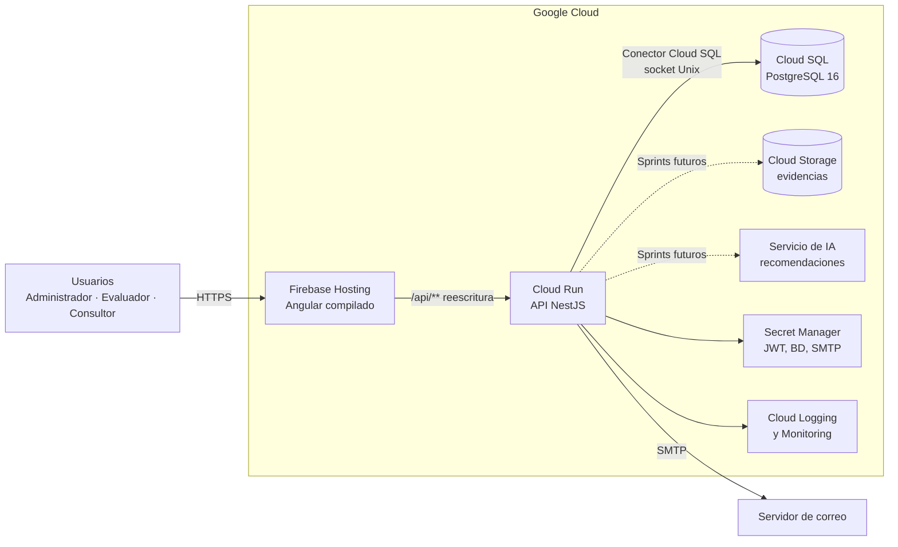
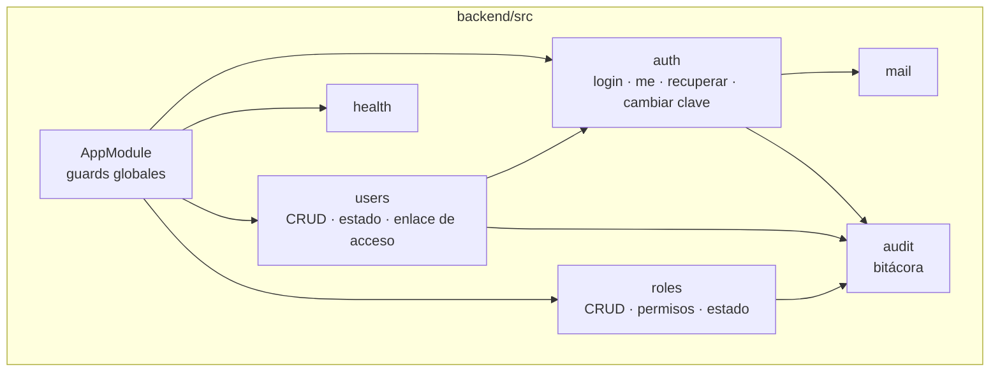
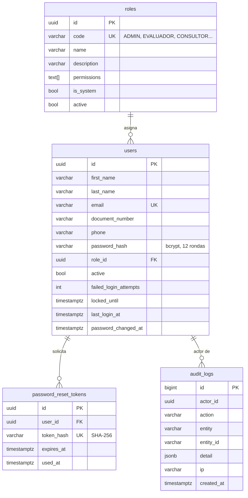
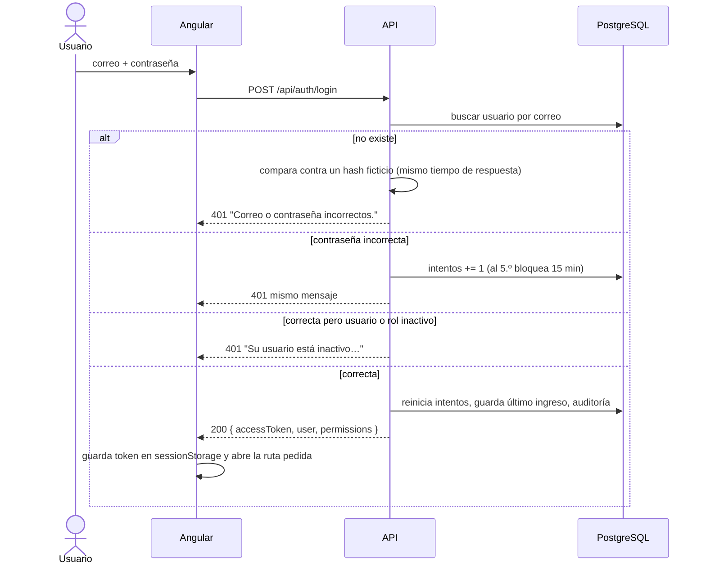
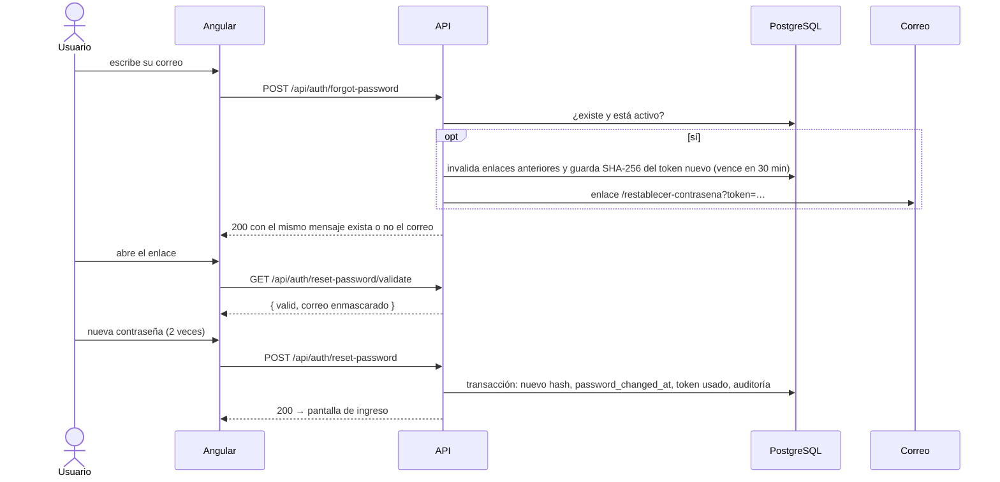

Arquitectura del sistema
========================

Este documento describe la arquitectura de ICA Bienestar Animal, aplicación web para la evaluación del bienestar animal en fincas, desarrollada a partir del documento *Requerimientos funcionales Aplicación ICA – Bienestar Animal*. Se detallan los componentes del sistema, la forma en que se comunican la interfaz web, el servicio de aplicación y la base de datos, el modelo de datos, los servicios expuestos y el procedimiento de despliegue en Google Cloud.


Vista general
-------------

El siguiente diagrama presenta los componentes del sistema en el ambiente de producción. Las líneas punteadas corresponden a servicios previstos para sprints posteriores.



La tabla siguiente relaciona cada capa con la tecnología seleccionada y el requerimiento que atiende.

| Capa | Tecnología | Requerimiento |
|---|---|---|
| Interfaz web | Angular 20, con componentes independientes, señales y sin zone.js | RNF01, RNF13, RNF16 |
| Servicio de aplicación | NestJS 11 y TypeORM sobre Node.js 22 | Recomendación técnica del documento de requerimientos |
| Base de datos | PostgreSQL 16, administrado con Cloud SQL en producción | RNFG03 |
| Autenticación | Tokens JWT firmados con HS256 y contraseñas cifradas con bcrypt | RF01, RNF05 |
| Correo | SMTP con nodemailer | RF04 |
| Despliegue | Firebase Hosting, Cloud Run y Cloud SQL | RNF02, RNFG01 |
| Credenciales | Variables de entorno provistas por Secret Manager | RNFG06 |


Comunicación entre componentes
------------------------------

**Interfaz web y servicio de aplicación**

La interfaz web invoca siempre la ruta relativa `/api`, de modo que ambos componentes comparten dominio y no se requiere CORS en producción. La redirección de esa ruta depende del ambiente:

| Ambiente | Mecanismo | Configuración |
|---|---|---|
| Desarrollo | El servidor de desarrollo de Angular redirige `/api` hacia `http://localhost:3000` | `frontend/proxy.conf.json` |
| Contenedores locales | nginx redirige `/api/` hacia el contenedor `api` | `frontend/nginx.conf` |
| Producción | Firebase Hosting redirige `/api/**` hacia el servicio de Cloud Run `ica-bienestar-api` | `frontend/firebase.json` |

Cada petición incluye la cabecera `Authorization: Bearer <token>`, agregada por el interceptor `core/interceptors/auth.interceptor.ts`. Cuando el servicio responde con el código 401, el interceptor cierra la sesión y redirige a la pantalla de ingreso. El token se conserva en `sessionStorage` y se elimina al cerrar el navegador.

**Servicio de aplicación y base de datos**

El archivo `backend/src/config/configuration.ts` construye la conexión de TypeORM. En el ambiente local se usan las variables `DB_HOST` y `DB_PORT`; en Cloud Run se usa `DB_SOCKET_PATH=/cloudsql/<proyecto>:<región>:<instancia>`, a través del conector de Cloud SQL y sin dirección IP pública.

El esquema de la base de datos se administra exclusivamente mediante migraciones (`synchronize: false`), ubicadas en `backend/src/database/migrations`. El comando `npm run seed` crea los roles base y el primer administrador, y puede ejecutarse varias veces sin duplicar información.

**Servicio de aplicación y correo electrónico**

El componente `MailService` envía los mensajes por SMTP. En desarrollo, cuando la variable `SMTP_HOST` está vacía, el contenido del mensaje se escribe en el registro del servicio para permitir copiar el enlace. En producción el servicio no inicia sin un servidor SMTP configurado.


Módulos del servicio de aplicación
----------------------------------

El servicio se organiza en módulos de NestJS con responsabilidades separadas, como se muestra a continuación.



Toda petición atraviesa tres guardas globales, en el orden indicado en la tabla.

| Guarda | Función |
|---|---|
| `ThrottlerGuard` | Limita el número de peticiones. El inicio de sesión admite 10 por minuto y la solicitud de recuperación, 5 |
| `JwtAuthGuard` | Exige un token válido, salvo en las rutas marcadas con `@Public()`. La estrategia vuelve a consultar el usuario en cada petición, de modo que una inactivación, un cambio de rol o un cambio de contraseña surten efecto de inmediato |
| `PermissionsGuard` | Verifica los permisos exigidos con `@RequirePermissions(...)` frente a los permisos del rol del usuario (RNF07) |

La incorporación de un módulo nuevo, como fincas o evaluaciones, consiste en crear su carpeta en `src/`, registrar sus permisos en `roles/constants/permissions.ts` y proteger cada ruta con `@RequirePermissions`.


Modelo de datos del primer sprint
---------------------------------

El diagrama de entidad y relación presenta las tablas creadas por la migración inicial.



Los permisos se almacenan como un arreglo dentro de cada rol, en lugar de una tabla intermedia. La decisión obedece a que el catálogo es reducido (doce permisos), cambia únicamente cuando se agrega un módulo y, de esta forma, se obtiene en una sola consulta por petición.


Flujos de seguridad
-------------------

**Inicio de sesión (RF01)**

El diagrama de secuencia describe la validación de credenciales, el bloqueo por intentos fallidos y la emisión del token.



**Recuperación de contraseña (RF04)**

El diagrama de secuencia describe la solicitud del enlace, su validación y el registro de la nueva contraseña.



El mismo mecanismo se emplea como invitación: cuando un administrador crea un usuario, la persona recibe un enlace con vigencia de 72 horas para definir su contraseña. En ningún momento el administrador conoce la contraseña.


Servicios de la API en el primer sprint
---------------------------------------

En el ambiente de desarrollo, la documentación interactiva de la API, generada con Swagger, está disponible en `http://localhost:3000/api/docs`. La tabla siguiente resume los servicios publicados.

| Método | Ruta | Permiso requerido | Descripción |
|---|---|---|---|
| POST | `/api/auth/login` | Ninguno | Inicio de sesión |
| GET | `/api/auth/me` | Sesión activa | Usuario autenticado y sus permisos |
| POST | `/api/auth/forgot-password` | Ninguno | Solicitud del enlace de recuperación |
| GET | `/api/auth/reset-password/validate?token=` | Ninguno | Verificación de la vigencia del enlace |
| POST | `/api/auth/reset-password` | Ninguno | Registro de la nueva contraseña |
| POST | `/api/auth/change-password` | Sesión activa | Cambio de la contraseña propia |
| GET | `/api/users` | `usuarios.ver` o `usuarios.gestionar` | Consulta con búsqueda, filtros y paginación |
| GET | `/api/users/:id` | `usuarios.ver` o `usuarios.gestionar` | Detalle de un usuario |
| POST | `/api/users` | `usuarios.gestionar` | Creación del usuario y envío de la invitación |
| PATCH | `/api/users/:id` | `usuarios.gestionar` | Edición de datos o del rol |
| PATCH | `/api/users/:id/status` | `usuarios.gestionar` | Activación o inactivación |
| POST | `/api/users/:id/access-link` | `usuarios.gestionar` | Reenvío del enlace de acceso |
| GET | `/api/roles` | `roles.ver` o `usuarios.gestionar` | Consulta de roles con el número de usuarios |
| GET | `/api/roles/permissions` | `roles.ver` | Catálogo de permisos |
| GET | `/api/roles/:id` | `roles.ver` | Detalle de un rol |
| POST | `/api/roles` | `roles.gestionar` | Creación de un rol |
| PATCH | `/api/roles/:id` | `roles.gestionar` | Edición de nombre, descripción y permisos |
| PATCH | `/api/roles/:id/status` | `roles.gestionar` | Activación o inactivación |
| GET | `/api/health` | Ninguno | Estado del servicio y de la base de datos |

El servicio aplica las siguientes reglas de negocio:

- El correo electrónico es único y se almacena en minúsculas.
- Un administrador no puede inactivar su propia cuenta ni cambiar su propio rol, y siempre debe existir al menos un administrador activo.
- Los roles base (Administrador, Evaluador y Consultor externo) no pueden inactivarse, y el rol Administrador conserva todos los permisos.
- Un rol solo puede inactivarse cuando ningún usuario activo lo tiene asignado.
- La contraseña debe tener entre 10 y 72 caracteres e incluir al menos una letra y un número.


Interfaz web
------------

La aplicación Angular se organiza en las carpetas descritas a continuación. Cada módulo funcional se carga de forma diferida al acceder a su ruta.

| Carpeta | Contenido |
|---|---|
| `core/` | Servicios sin interfaz gráfica: sesión, acceso a la API, interceptor, guardas de rutas y modelos |
| `shared/` | Componentes reutilizables: diálogo, campo de contraseña, mensajes emergentes y encabezado de página |
| `layout/` | Estructura principal con barra superior translúcida, que en pantallas pequeñas se convierte en un menú desplegable |
| `features/auth/` | Ingreso, recuperación y creación de contraseña |
| `features/home/` | Pantalla de inicio |
| `features/users/` | Gestión de usuarios |
| `features/roles/` | Gestión de roles y permisos |
| `features/account/` | Datos de la cuenta y cambio de contraseña |

Las rutas internas están protegidas por `authGuard` y `permissionGuard`. El menú presenta únicamente las secciones que el rol permite; no obstante, el control de acceso efectivo lo ejerce el servicio de aplicación. Los estilos se basan en variables CSS definidas en `src/styles.scss`, descritas en el [sistema de diseño](SISTEMA-DE-DISENO.md).


Despliegue en Google Cloud
--------------------------

El sistema contempla tres ambientes independientes, cada uno asociado a una rama del repositorio.

| Ambiente | Proyecto de Google Cloud | Rama |
|---|---|---|
| Desarrollo | `ica-bienestar-dev` | `develop` |
| Pruebas | `ica-bienestar-qa` | `release/*` |
| Producción | `ica-bienestar-prod` | `main` |

Cada ambiente dispone de su propia instancia de Cloud SQL y de sus propios secretos (RNFG07). El procedimiento de despliegue de un ambiente se describe a continuación.

**Base de datos**

```bash
gcloud sql instances create ica-bienestar-db --database-version=POSTGRES_16 --region=us-central1 --tier=db-g1-small --backup-start-time=06:00 --enable-point-in-time-recovery
gcloud sql databases create ica_bienestar --instance=ica-bienestar-db
gcloud sql users create ica --instance=ica-bienestar-db --password=<clave>
```

**Secretos**

```bash
printf '%s' "$(openssl rand -base64 48)" | gcloud secrets create jwt-secret --data-file=-
printf '%s' '<clave-bd>' | gcloud secrets create db-password --data-file=-
printf '%s' '<clave-smtp>' | gcloud secrets create smtp-password --data-file=-
```

**Servicio de aplicación en Cloud Run**

```bash
gcloud run deploy ica-bienestar-api --source backend --region us-central1 \
  --add-cloudsql-instances <proyecto>:us-central1:ica-bienestar-db \
  --set-env-vars NODE_ENV=production,DB_SOCKET_PATH=/cloudsql/<proyecto>:us-central1:ica-bienestar-db,DB_USER=ica,DB_NAME=ica_bienestar,DB_MIGRATIONS_RUN=true,FRONTEND_URL=https://<dominio>,SMTP_HOST=<host>,SMTP_USER=<usuario> \
  --set-secrets JWT_SECRET=jwt-secret:latest,DB_PASSWORD=db-password:latest,SMTP_PASSWORD=smtp-password:latest
```

**Interfaz web en Firebase Hosting**

```bash
cd frontend && npx ng build && npx firebase-tools deploy --only hosting
```

Con la variable `DB_MIGRATIONS_RUN=true`, las migraciones pendientes se aplican al iniciar el servicio. La carga de datos iniciales se ejecuta una vez por ambiente con `npm run seed:prod`, por ejemplo mediante un Cloud Run Job.

**Observabilidad**

En atención a los requerimientos RNF22 y RNFG05, Cloud Run envía la salida estándar del servicio a Cloud Logging, y la ruta `/api/health` se utiliza como verificación de disponibilidad en Cloud Monitoring.
