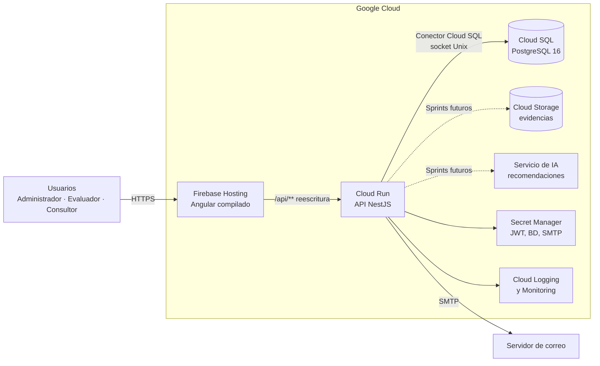
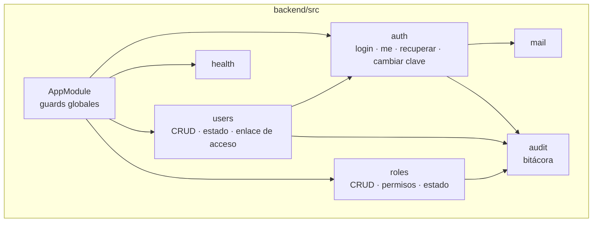
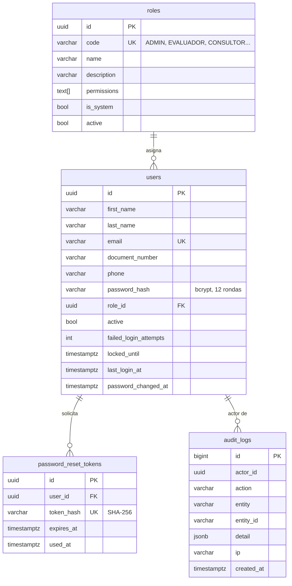
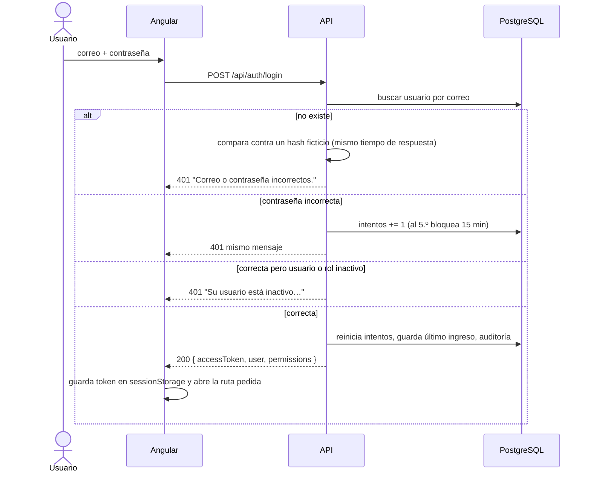
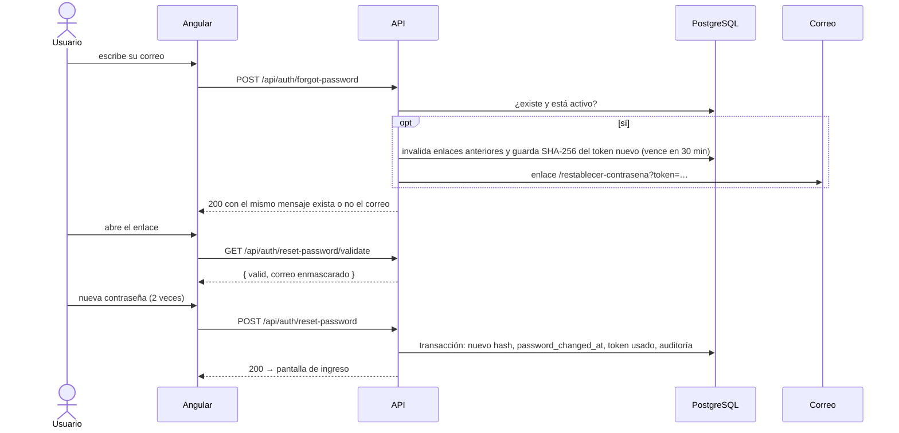

# Arquitectura del sistema

Aplicación web para evaluar el bienestar animal en fincas (documento *Requerimientos funcionales Aplicación ICA – Bienestar Animal*). Este documento describe cómo se conectan frontend, backend y base de datos, y cómo se despliega en Google Cloud.

## 1. Vista general



| Capa | Tecnología | Requerimiento |
|---|---|---|
| Frontend | Angular 20 (componentes standalone, signals, sin zone.js) | RNF01, RNF13, RNF16 |
| Backend | NestJS 11 + TypeORM sobre Node.js 22 | Recomendación técnica del documento |
| Base de datos | PostgreSQL 16 (Cloud SQL en producción) | RNFG03 |
| Autenticación | JWT firmado (HS256) + contraseñas con bcrypt | RF01, RNF05 |
| Correo | SMTP con nodemailer | RF04 |
| Despliegue | Firebase Hosting + Cloud Run + Cloud SQL | RNF02, RNFG01 |
| Credenciales | Variables de entorno desde Secret Manager | RNFG06 |

## 2. Cómo se conectan las partes

### Frontend → Backend

- El frontend llama siempre a la ruta relativa `/api`, así que **frontend y API comparten dominio** y no hace falta CORS en producción.
  - Desarrollo: `ng serve` usa `frontend/proxy.conf.json` para enviar `/api` a `http://localhost:3000`.
  - Docker local: nginx (`frontend/nginx.conf`) reenvía `/api/` al contenedor `api`.
  - Producción: Firebase Hosting reescribe `/api/**` al servicio de Cloud Run `ica-bienestar-api` (`frontend/firebase.json`).
- Cada petición lleva `Authorization: Bearer <token>`, que agrega `core/auth.interceptor.ts`. Si la API responde 401, el interceptor cierra la sesión y lleva al ingreso.
- El token se guarda en `sessionStorage` y se pierde al cerrar el navegador.

### Backend → Base de datos

- `backend/src/config/configuration.ts` arma la conexión de TypeORM:
  - Local: `DB_HOST` y `DB_PORT`.
  - Cloud Run: `DB_SOCKET_PATH=/cloudsql/<proyecto>:<región>:<instancia>` con el conector de Cloud SQL, sin IP pública.
- El esquema se maneja **solo con migraciones** (`synchronize: false`). Están en `backend/src/database/migrations`.
- `npm run seed` crea los roles base y el primer administrador. Se puede ejecutar varias veces sin duplicar datos.

### Backend → Correo

- `MailService` envía por SMTP. Si `SMTP_HOST` está vacío (solo en desarrollo), el correo se escribe en el log de la API para poder copiar el enlace. En producción la API no arranca sin SMTP.

## 3. Módulos del backend



Cada petición pasa por tres guards globales, en este orden:

1. `ThrottlerGuard`: límite de peticiones. El login acepta 10 por minuto y la recuperación 5.
2. `JwtAuthGuard`: exige token salvo en las rutas `@Public()`. La estrategia **vuelve a leer el usuario en cada petición**, así que una inactivación, un cambio de rol o un cambio de contraseña aplican de inmediato.
3. `PermissionsGuard`: revisa `@RequirePermissions(...)` contra los permisos del rol (RNF07).

Para agregar un módulo nuevo (fincas, evaluaciones…) se crea su carpeta en `src/`, se agregan sus permisos a `roles/permissions.ts` y se protege cada ruta con `@RequirePermissions`.

## 4. Modelo de datos (Sprint 1)



Los permisos se guardan como arreglo en el rol en lugar de una tabla intermedia. Son pocos (12), cambian solo cuando se agrega un módulo y así se leen en una sola consulta por petición.

## 5. Flujos de seguridad

### Inicio de sesión (RF01)



### Recuperación de contraseña (RF04)



El mismo mecanismo sirve de **invitación**: cuando un administrador crea un usuario, este recibe un enlace (válido por 72 h) para definir su contraseña. El administrador nunca conoce la clave.

## 6. API (Sprint 1)

Con la API en desarrollo, la documentación interactiva queda en `http://localhost:3000/api/docs` (Swagger).

| Método | Ruta | Permiso | Uso |
|---|---|---|---|
| POST | `/api/auth/login` | público | Ingreso |
| GET | `/api/auth/me` | sesión | Usuario actual y permisos |
| POST | `/api/auth/forgot-password` | público | Pide el enlace de recuperación |
| GET | `/api/auth/reset-password/validate?token=` | público | Revisa si el enlace sigue vigente |
| POST | `/api/auth/reset-password` | público | Define la nueva contraseña |
| POST | `/api/auth/change-password` | sesión | Cambia la contraseña propia |
| GET | `/api/users` | `usuarios.ver` o `usuarios.gestionar` | Lista con búsqueda, filtros y paginación |
| GET | `/api/users/:id` | `usuarios.ver` o `usuarios.gestionar` | Detalle |
| POST | `/api/users` | `usuarios.gestionar` | Crea y envía la invitación |
| PATCH | `/api/users/:id` | `usuarios.gestionar` | Edita datos o rol |
| PATCH | `/api/users/:id/status` | `usuarios.gestionar` | Activa o inactiva |
| POST | `/api/users/:id/access-link` | `usuarios.gestionar` | Reenvía el enlace de acceso |
| GET | `/api/roles` | `roles.ver` o `usuarios.gestionar` | Lista con conteo de usuarios |
| GET | `/api/roles/permissions` | `roles.ver` | Catálogo de permisos |
| GET | `/api/roles/:id` | `roles.ver` | Detalle |
| POST | `/api/roles` | `roles.gestionar` | Crea un rol |
| PATCH | `/api/roles/:id` | `roles.gestionar` | Edita nombre, descripción y permisos |
| PATCH | `/api/roles/:id/status` | `roles.gestionar` | Activa o inactiva |
| GET | `/api/health` | público | Estado de la API y de la base |

Reglas de negocio que aplica la API:

- El correo es único y se guarda en minúsculas.
- Un administrador no puede inactivarse ni cambiar su propio rol, y siempre debe quedar al menos un administrador activo.
- Los roles base (Administrador, Evaluador, Consultor externo) no se pueden inactivar, y el Administrador conserva todos los permisos.
- Un rol solo se inactiva si ningún usuario activo lo tiene.
- La contraseña debe tener entre 10 y 72 caracteres, con al menos una letra y un número.

## 7. Frontend

```
frontend/src/app/
├── core/        servicios sin interfaz: auth, api, interceptor, guards, modelos
├── shared/      componentes reutilizables: diálogo, campo de contraseña, avisos, encabezado
├── layout/      shell con navegación lateral (cajón en móvil)
└── features/    una carpeta por módulo, con carga diferida por ruta
    ├── auth/    ingreso, recuperar y crear contraseña
    ├── home/
    ├── users/
    ├── roles/
    └── account/
```

- Las rutas internas usan `authGuard` y `permissionGuard`. El menú solo muestra lo que el rol permite, aunque la seguridad real la aplica la API.
- Los estilos se basan en variables CSS definidas en `src/styles.scss` (ver [SISTEMA-DE-DISENO.md](SISTEMA-DE-DISENO.md)).

## 8. Despliegue en Google Cloud

| Ambiente | Proyecto GCP | Rama |
|---|---|---|
| Desarrollo | `ica-bienestar-dev` | `develop` |
| Pruebas | `ica-bienestar-qa` | `release/*` |
| Producción | `ica-bienestar-prod` | `main` |

Cada ambiente tiene su propia instancia de Cloud SQL y sus propios secretos (RNFG07). Pasos para un ambiente:

```bash
# 1. Base de datos
gcloud sql instances create ica-bienestar-db --database-version=POSTGRES_16 --region=us-central1 --tier=db-g1-small
gcloud sql databases create ica_bienestar --instance=ica-bienestar-db
gcloud sql users create ica --instance=ica-bienestar-db --password=<clave>

# 2. Secretos
printf '%s' "$(openssl rand -base64 48)" | gcloud secrets create jwt-secret --data-file=-
printf '%s' '<clave-bd>' | gcloud secrets create db-password --data-file=-
printf '%s' '<clave-smtp>' | gcloud secrets create smtp-password --data-file=-

# 3. API en Cloud Run
gcloud run deploy ica-bienestar-api --source backend --region us-central1 \
  --add-cloudsql-instances <proyecto>:us-central1:ica-bienestar-db \
  --set-env-vars NODE_ENV=production,DB_SOCKET_PATH=/cloudsql/<proyecto>:us-central1:ica-bienestar-db,DB_USER=ica,DB_NAME=ica_bienestar,DB_MIGRATIONS_RUN=true,FRONTEND_URL=https://<dominio>,SMTP_HOST=<host>,SMTP_USER=<usuario> \
  --set-secrets JWT_SECRET=jwt-secret:latest,DB_PASSWORD=db-password:latest,SMTP_PASSWORD=smtp-password:latest

# 4. Frontend en Firebase Hosting
cd frontend && npx ng build && npx firebase-tools deploy --only hosting
```

Con `DB_MIGRATIONS_RUN=true`, las migraciones pendientes se aplican al arrancar la API. El seed se ejecuta una vez por ambiente con `npm run seed:prod`, por ejemplo con un Cloud Run Job.

Observabilidad (RNF22, RNFG05): Cloud Run envía la salida estándar a Cloud Logging. `/api/health` sirve como verificación de disponibilidad (uptime check) en Cloud Monitoring.
