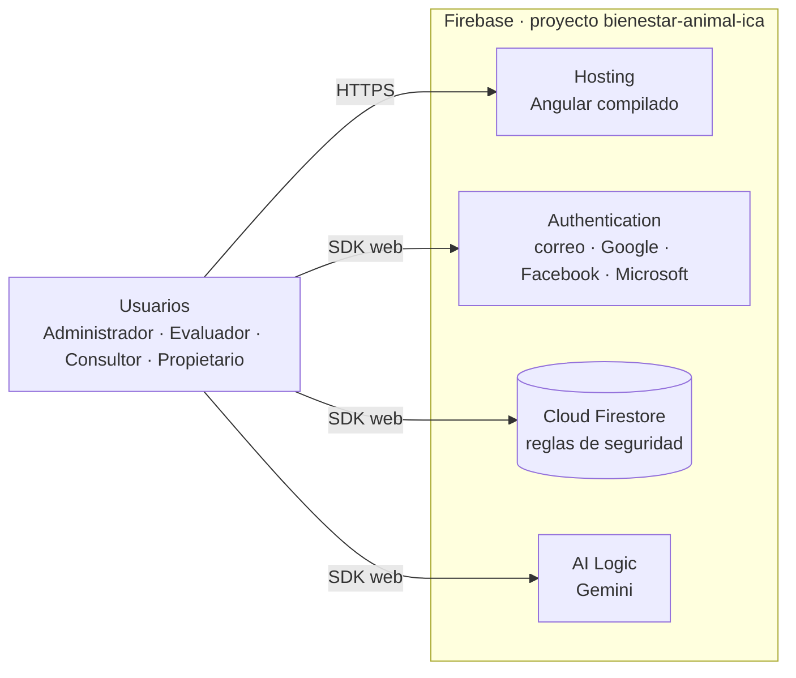
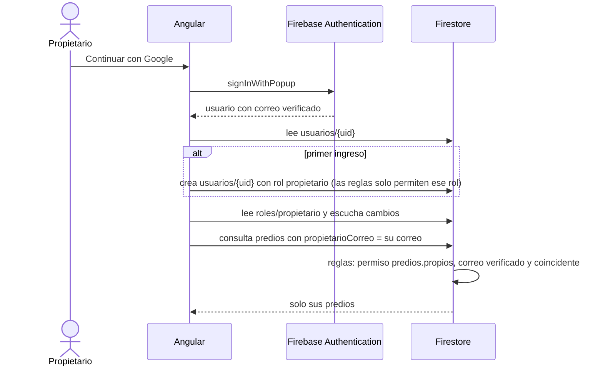
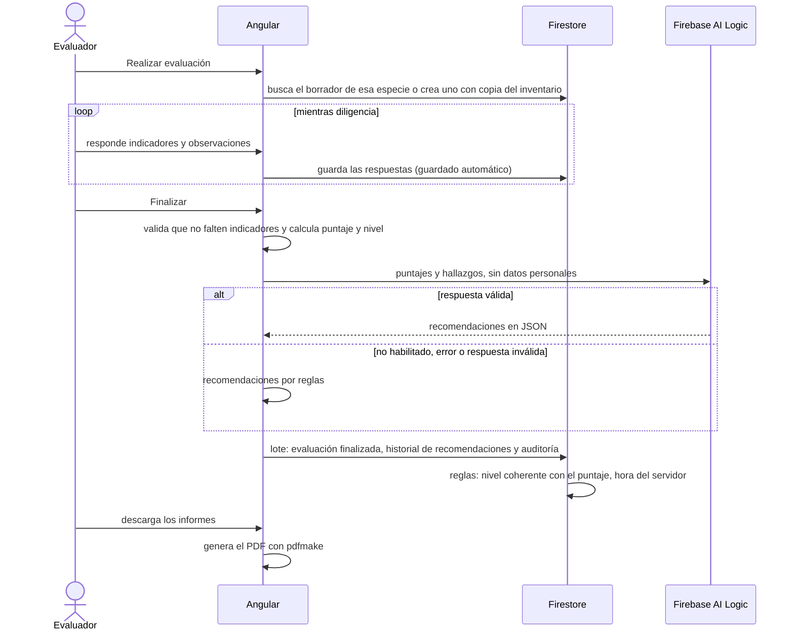

Arquitectura del sistema
========================

Este documento describe la arquitectura de ICA Bienestar Animal, aplicación web para la evaluación del bienestar animal en predios según la norma del ICA. Se detallan los componentes, la forma en que la interfaz se comunica con Firebase, la separación entre autenticación y autorización, los flujos principales y las operaciones sobre los datos. La publicación se describe en [DESPLIEGUE.md](DESPLIEGUE.md).


Vista general
-------------

La aplicación es una interfaz Angular que trabaja directamente con los servicios de Firebase del proyecto `bienestar-animal-ica`. No hay un servidor propio: la seguridad de los datos la garantizan las reglas de Firestore, que se evalúan en los servidores de Google.



| Capa | Tecnología | Requerimiento |
|---|---|---|
| Interfaz web | Angular 20, con componentes independientes, señales y carga diferida por ruta | RNF01, RNF13, RNF16 |
| Base de datos | Cloud Firestore | Sección *Base de datos* |
| Autenticación | Firebase Authentication: correo y contraseña, Google, Facebook y Microsoft | Sección *Autenticación* |
| Autorización | Roles y permisos en Firestore, aplicados por las reglas de seguridad | RNF07 |
| Inteligencia artificial | Firebase AI Logic con un modelo Gemini, con respaldo por reglas | RF24, RNF25, RNF26 |
| Informes | pdfmake en el navegador | Sección *Informes* |
| Publicación | Firebase Hosting | Sección *Implementación y administración de servidores* |


Comunicación con Firebase
-------------------------

**Conexión.** `core/firebase/conexion.ts` inicializa Firebase con la configuración de `src/environments/firebase.config.ts`. El SDK se descarga solo la primera vez que se usa. En el ambiente de emuladores, la misma conexión apunta a Auth y Firestore en el equipo local.

**Servicios de la interfaz.** Las pantallas usan tres servicios con la misma interfaz en todos los ambientes:

| Servicio | Con Firebase | En el modo demostración |
|---|---|---|
| `AuthService` | `core/services/sesion/sesion-firebase.ts` | `sesion-demo.ts`, contra la API simulada |
| `ApiService` (usuarios y roles) | `core/firebase/usuarios-roles.ts` | API simulada en `core/demo/` |
| `FarmsApiService` (predios, evaluaciones e informes) | `core/firebase/predios-evaluaciones.ts` | API simulada en `core/demo/` |

**Reglas compartidas.** La norma del ICA (libertades, ponderaciones, niveles, tipo de productor y muestra mínima), los 23 criterios con sus indicadores, el cálculo del puntaje, las recomendaciones por reglas, las instrucciones de la IA, los permisos y los informes PDF se escriben una sola vez en `compartido/`. El script `scripts/compartido.mjs` los copia a la interfaz y a `firebase/`, y la integración continua falla si alguna copia está desactualizada.

**Errores.** `core/utils/http-error.ts` traduce los códigos de Firebase (`auth/invalid-credential`, `permission-denied`…) a mensajes en español.


Autenticación y autorización
----------------------------

El sistema separa dos preguntas:

- **Autenticación: ¿quién es?** La responde Firebase Authentication, con correo y contraseña o con Google, Facebook o Microsoft. El resultado es un token firmado con el identificador y el correo de la persona, y si el correo está verificado.
- **Autorización: ¿qué puede hacer?** La responden el documento `usuarios/{uid}` (rol y estado) y los permisos del rol en `roles/{rol}`. La interfaz los usa para mostrar u ocultar secciones; las reglas de Firestore los vuelven a comprobar en cada operación.



| Rol base | Permisos | Alcance |
|---|---|---|
| Administrador | Todos | Gestión completa |
| Evaluador | Predios, evaluaciones y reportes | Registra y edita predios, diligencia evaluaciones |
| Consultor externo | Consulta de predios, evaluaciones y reportes | Solo lectura |
| Propietario del predio | `predios.propios` | Sus predios, las evaluaciones finalizadas, las recomendaciones y los informes |

La sesión escucha los documentos del usuario y de su rol: si el administrador lo inactiva o le cambia los permisos, la interfaz lo refleja de inmediato y, si pierde el acceso, cierra la sesión.


Flujos principales
------------------

**Creación de un usuario por el administrador**

Firebase cierra la sesión actual cuando se crea una cuenta desde el navegador. Para que el administrador no pierda la suya, la cuenta se crea en una segunda instancia de Firebase.

```mermaid
sequenceDiagram
    actor Ad as Administrador
    participant W as Angular
    participant A2 as Authentication (instancia aparte)
    participant F as Firestore
    participant A as Authentication
    Ad->>W: datos y rol del usuario
    W->>A2: crea la cuenta con una contraseña aleatoria
    W->>A2: cierra esa instancia
    W->>F: lote: usuarios/{uid} y auditoría (reglas: usuarios.gestionar)
    W->>A: envía el correo para definir la contraseña
    Note over Ad,A: Nadie conoce la contraseña temporal; la persona define la suya con el enlace.
```

**Registro de un propietario**

La persona escribe sus datos y una contraseña. Se crea su cuenta, su documento en `usuarios` con el rol Propietario y se envía el correo de verificación. Hasta que no lo verifica, las reglas no le muestran ningún predio; la pantalla le indica qué hacer.

**Recuperación de contraseña**

`sendPasswordResetEmail` envía el enlace con la página de Firebase para definir la nueva contraseña. La respuesta en pantalla es la misma exista o no la cuenta.

**Evaluación de un predio**



**Cálculo del puntaje.** Cada indicador vale 1 si cumple, 0,5 si cumple en parte y 0 si no cumple; los que no aplican se excluyen. Dentro de cada libertad todos los indicadores pesan lo mismo, y el puntaje se lleva a una escala de 0 a 5. El total pondera los cuatro bloques en que la norma agrupa las cinco libertades: alimento y agua 20 %, salud 50 %, confort 15 % y comportamiento 15 %. El nivel es Bajo por debajo de 3, Medio de 3 a 3,9, Alto de 4 a 4,5 y Excelente desde 4,6, sobre el puntaje redondeado a un decimal.

**Criterios que aplican.** El sistema productivo del predio y su tamaño definen la lista: la castración solo se evalúa en carne y doble propósito, la mastitis en lechería y doble propósito, y los registros documentales y el uso de medicamentos solo en medianos y grandes productores.


Operaciones sobre los datos
---------------------------

| Operación | Colecciones | Permiso que exigen las reglas |
|---|---|---|
| Ingresar y leer la propia sesión | `usuarios/{uid}`, `roles/{rol}` | Sesión activa |
| Registrarse como propietario | `usuarios/{uid}` | Ser el mismo usuario, con rol propietario y su correo |
| Consultar usuarios | `usuarios`, `roles` | `usuarios.ver` o `usuarios.gestionar` |
| Crear, editar, activar e inactivar usuarios | `usuarios`, `auditoria` | `usuarios.gestionar` |
| Crear y editar roles | `roles`, `auditoria` | `roles.gestionar` |
| Consultar catálogos de la norma | `especies`, `libertades`, `niveles`, `criterios` | Sesión activa |
| Consultar todos los predios | `predios` | `fincas.ver` o `fincas.gestionar` |
| Consultar los predios propios | `predios` | `predios.propios`, correo verificado y coincidente |
| Registrar y editar predios | `predios`, `evaluaciones`, `recomendaciones`, `auditoria` | `fincas.gestionar` |
| Consultar evaluaciones e historial | `evaluaciones`, `recomendaciones` | `evaluaciones.ver`, `evaluaciones.diligenciar` o `reportes.ver`; el propietario, las finalizadas con su correo |
| Iniciar, guardar y finalizar evaluaciones | `evaluaciones`, `recomendaciones`, `auditoria` | `evaluaciones.diligenciar` |
| Consultar la bitácora | `auditoria` | `auditoria.ver` |

**Reglas de negocio**

- El correo es único, se guarda en minúsculas y no se cambia: identifica la cuenta en Firebase Authentication.
- Un administrador no puede inactivar su propia cuenta ni cambiar su propio rol, y siempre debe existir al menos un administrador activo.
- Los roles base no pueden inactivarse, y el rol Administrador conserva todos los permisos.
- Un rol solo puede inactivarse cuando ningún usuario activo lo tiene asignado.
- La contraseña debe tener entre 10 y 72 caracteres e incluir al menos una letra y un número.
- Un predio registra al menos una especie con animales, y cada especie una sola vez.
- Solo existe un borrador por predio y especie; una evaluación finalizada no se modifica.
- No se finaliza una evaluación con indicadores sin responder, y los indicadores de sí o no no admiten respuesta parcial.


Interfaz web
------------

Cada módulo funcional se carga de forma diferida al acceder a su ruta, y cada componente tiene su carpeta con archivos `.ts`, `.html` y `.scss`.

| Carpeta | Contenido |
|---|---|
| `core/firebase/` | Conexión, usuarios y roles, predios y evaluaciones, IA y bitácora sobre Firebase |
| `core/services/` | Sesión, usuarios y roles, y predios y evaluaciones, con la misma interfaz para Firebase y la demostración |
| `core/informes/` | Generación de los informes PDF |
| `core/demo/` | Modo demostración |
| `shared/` | Componentes reutilizables: diálogo, campo de contraseña, mensajes emergentes, encabezado de página y nivel de bienestar |
| `layout/` | Estructura principal con barra superior translúcida, que en pantallas pequeñas se convierte en un menú desplegable |
| `compartido/` | Copia de las reglas de la norma, los criterios, los permisos y los informes |
| `features/auth/` | Ingreso, ingreso con proveedores externos, registro, recuperación y creación de contraseña |
| `features/home/` | Pantalla de inicio con la guía de bienestar animal |
| `features/farms/` | Lista de predios, registro y ficha del predio con *Editar finca*, *Realizar evaluación* e historial |
| `features/evaluations/` | Formulario de evaluación por criterio con guardado automático, y pantalla de resultado |
| `features/users/`, `features/roles/`, `features/account/` | Usuarios, roles y permisos, y cuenta propia |

Las rutas internas están protegidas por `authGuard` y `permissionGuard`. El menú presenta solo las secciones que el rol permite y, para el propietario, la sección de predios se llama *Mis predios*. Los estilos se basan en variables CSS de `src/styles/_tokens.scss`, descritas en el [sistema de diseño](SISTEMA-DE-DISENO.md).


Pruebas
-------

| Prueba | Alcance |
|---|---|
| `firebase/pruebas/reglas.test.ts` | Reglas de seguridad en el emulador: acceso por rol, propietario, registro, roles protegidos, validación, evaluación finalizada, historial y bitácora |
| Pruebas unitarias de la interfaz | Sesión, mensajes de error, los 23 criterios, filtros por sistema y tamaño, ponderación, recomendaciones y redondeo |
| `frontend/e2e/` | Flujos completos con Playwright contra los emuladores, en escritorio y teléfono, con accesibilidad en modo claro y oscuro |
