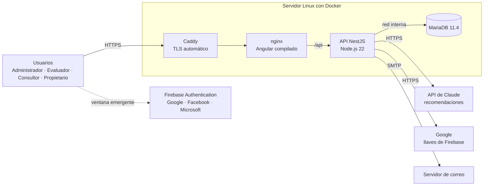
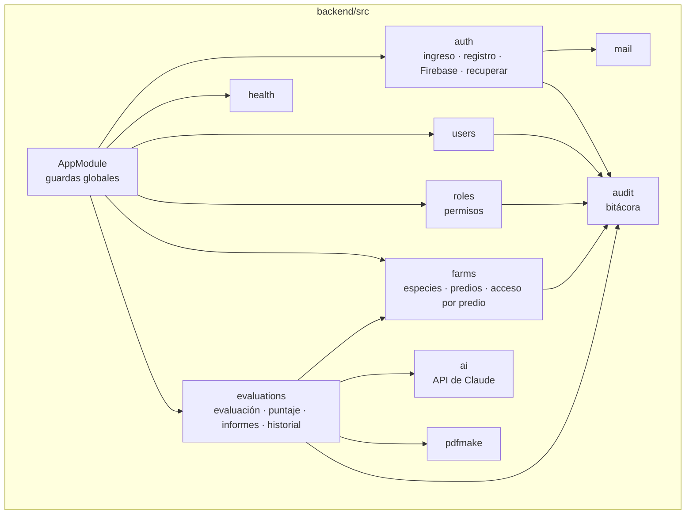
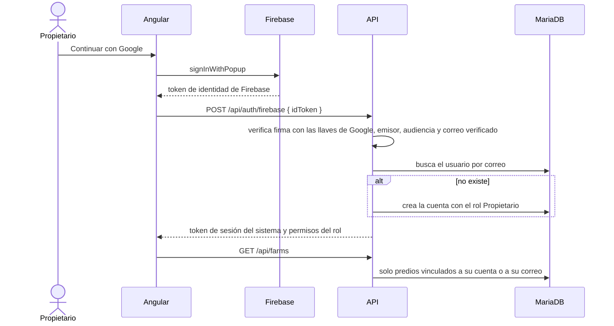
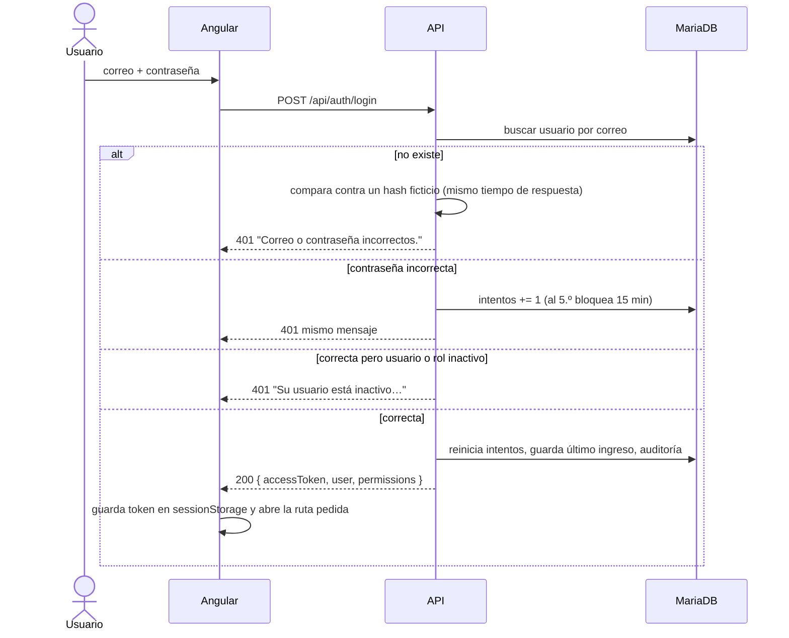
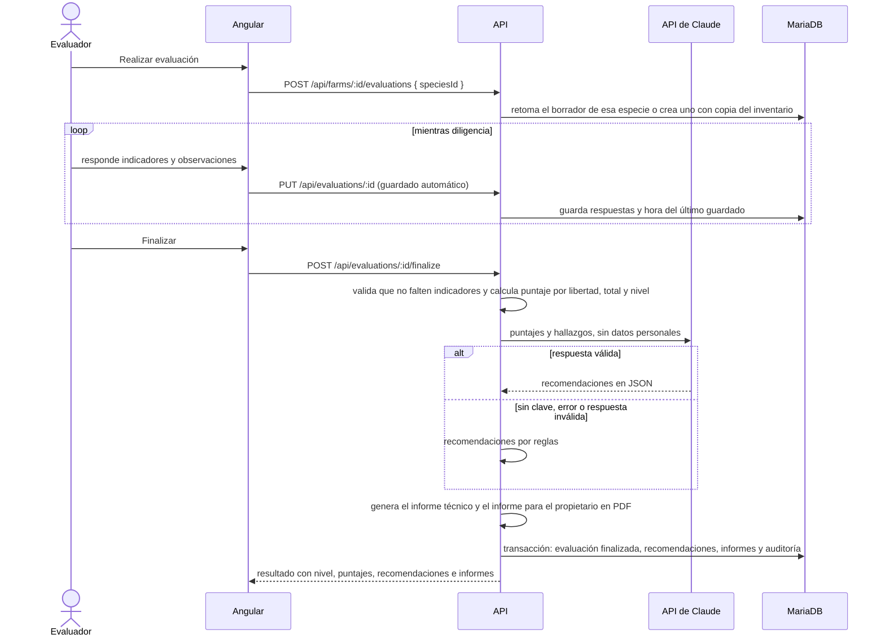

Arquitectura del sistema
========================

Este documento describe la arquitectura de ICA Bienestar Animal, aplicación web para la evaluación del bienestar animal en predios según la norma del ICA. Se detallan los componentes, la forma en que se comunican la interfaz web, el servicio de aplicación, la base de datos y los servicios externos, la separación entre autenticación y autorización, el flujo de una evaluación y los servicios expuestos. La puesta en producción se describe en [DESPLIEGUE.md](DESPLIEGUE.md).

Vista general
-------------

| Capa | Tecnología | Requerimiento |
|---|---|---|
| Interfaz web | Angular 20, con componentes independientes, señales y carga diferida por ruta | RNF01, RNF13, RNF16 |
| Servicio de aplicación | NestJS 11 y TypeORM sobre Node.js 22 | Recomendación técnica del documento de requerimientos |
| Base de datos | MariaDB 11.4, motor InnoDB y `utf8mb4` | Sección *Base de datos* |
| Autenticación | Correo y contraseña con bcrypt, o Firebase Authentication; sesión con tokens JWT firmados con HS256 | Sección *Autenticación*, RNF05 |
| Autorización | Roles y permisos propios guardados en MariaDB; acceso por predio para el propietario | RNF07 |
| Inteligencia artificial | API de Claude con salida estructurada, con respaldo por reglas | RF24, RNF25, RNF26 |
| Informes | pdfmake, con las mismas definiciones en el servidor y en el modo demostración | Sección *Informes* |
| Correo | SMTP con nodemailer | RF04 |
| Despliegue | Docker Compose, Caddy, nginx y respaldos programados | Sección *Implementación y administración de servidores* |

Comunicación entre componentes
------------------------------

**Interfaz web y servicio de aplicación**

La interfaz web invoca siempre la ruta relativa `/api`, de modo que ambos componentes comparten dominio y no se requiere CORS en producción. La redirección de esa ruta depende del ambiente:

| Ambiente | Mecanismo | Configuración |
|---|---|---|
| Desarrollo | El servidor de desarrollo de Angular redirige `/api` hacia `http://localhost:3000` | `frontend/proxy.conf.json` |
| Contenedores y servidor | nginx redirige `/api/` hacia el contenedor `api` | `frontend/nginx.conf` |
| Modo demostración | Un interceptor responde dentro del navegador, sin servicio de aplicación | `frontend/src/app/core/demo/` |

Cada petición incluye la cabecera `Authorization: Bearer <token>`, agregada por el interceptor `core/interceptors/auth.interceptor.ts`. Cuando el servicio responde con el código 401, el interceptor cierra la sesión y redirige a la pantalla de ingreso. El token se conserva en `sessionStorage` y se elimina al cerrar el navegador.

**Servicio de aplicación y base de datos**

El archivo `backend/src/config/configuration.ts` construye la conexión de TypeORM con el controlador de MariaDB (`mysql2`), por TCP con `DB_HOST` y `DB_PORT` o por el socket Unix de `DB_SOCKET_PATH`. Las fechas se guardan en UTC.

El esquema se administra exclusivamente mediante migraciones (`synchronize: false`), ubicadas en `backend/src/database/migrations`. El comando `npm run seed` crea los roles base, las especies y el primer administrador, y puede ejecutarse varias veces sin duplicar información. El diseño completo está en [base-de-datos/DISENO-BASE-DE-DATOS.md](base-de-datos/DISENO-BASE-DE-DATOS.md).

**Servicio de aplicación y servicios externos**

| Servicio | Uso | Si no está configurado o falla |
|---|---|---|
| API de Claude | Redacta las recomendaciones para el propietario a partir de los puntajes y los hallazgos, sin datos personales | Se generan con reglas a partir de la lista de chequeo y el informe lo indica |
| Google (llaves públicas de Firebase) | Valida la firma de los tokens de Firebase | No se muestran los botones de Google, Facebook y Microsoft |
| Servidor SMTP | Invitaciones, registro de propietarios y recuperación de contraseña | En desarrollo el mensaje se escribe en el registro; en producción el servicio no inicia |

**Reglas compartidas**

La norma del ICA (libertades, ponderaciones, niveles, tipo de productor y muestra mínima), la lista de chequeo, el cálculo del puntaje, las recomendaciones por reglas y las definiciones de los informes PDF se escriben una sola vez en la carpeta `compartido/`. El script `scripts/compartido.mjs` las copia a `backend/src/compartido` y a `frontend/src/app/compartido`, y la integración continua falla si alguna copia está desactualizada. Así, la interfaz muestra el tipo de productor mientras se diligencia el formulario con exactamente las mismas reglas que aplica el servidor.

Módulos del servicio de aplicación
----------------------------------

Toda petición atraviesa tres guardas globales, en el orden indicado en la tabla.

| Guarda | Función |
|---|---|
| `ThrottlerGuard` | Limita el número de peticiones por IP. El inicio de sesión admite 10 por minuto; el registro y la solicitud de recuperación, 5 |
| `JwtAuthGuard` | Exige un token válido, salvo en las rutas marcadas con `@Public()`. La estrategia vuelve a consultar el usuario en cada petición, de modo que una inactivación, un cambio de rol o un cambio de contraseña surten efecto de inmediato |
| `PermissionsGuard` | Verifica los permisos exigidos con `@RequirePermissions(...)` frente a los permisos del rol del usuario (RNF07) |

Autenticación y autorización
----------------------------

El sistema separa dos preguntas:

- **Autenticación: ¿quién es?** Se responde con correo y contraseña, verificados por el propio servicio con bcrypt, o con un proveedor externo (Google, Facebook o Microsoft) a través de Firebase Authentication. En ambos casos el resultado es el mismo token de sesión del sistema.
- **Autorización: ¿qué puede hacer?** Se responde siempre con el rol del usuario guardado en MariaDB y sus permisos. Firebase no interviene en esta decisión.

| Rol base | Permisos | Alcance |
|---|---|---|
| Administrador | Todos | Gestión completa |
| Evaluador | Predios, evaluaciones y reportes | Registra y edita predios, diligencia evaluaciones |
| Consultor externo | Consulta de predios, evaluaciones y reportes | Solo lectura |
| Propietario del predio | `predios.propios` | Sus predios, las evaluaciones finalizadas, las recomendaciones y los informes |

Un propietario puede crear su cuenta desde la pantalla de registro; recibe por correo un enlace para definir su contraseña, de modo que el correo queda verificado. Sus predios aparecen cuando el evaluador registra ese mismo correo en los datos del predio.

Flujos principales
------------------

**Inicio de sesión (RF01)**

El diagrama de secuencia describe la validación de credenciales, el bloqueo por intentos fallidos y la emisión del token.

**Recuperación de contraseña (RF04)**

El diagrama de secuencia describe la solicitud del enlace, su validación y el registro de la nueva contraseña.

El mismo mecanismo se emplea como invitación: cuando un administrador crea un usuario, la persona recibe un enlace con vigencia de 72 horas para definir su contraseña. En ningún momento el administrador conoce la contraseña.

**Evaluación de un predio**

El evaluador abre el predio y elige *Realizar evaluación*. La norma exige una evaluación independiente por especie, de modo que si el predio cría varias, se elige cuál evaluar. La evaluación guarda una copia del inventario y calcula el tipo de productor y la muestra mínima.

**Cálculo del puntaje.** Cada indicador vale 1 si cumple, 0,5 si cumple parcialmente y 0 si no cumple; los que no aplican se excluyen. El puntaje de cada bloque es el promedio ponderado por el peso de sus indicadores, llevado a una escala de 0 a 5. El puntaje total pondera los cuatro bloques en que la norma agrupa las cinco libertades: alimento y agua 20 %, salud 50 %, confort 15 % y comportamiento 15 %. El nivel es Bajo por debajo de 3, Medio de 3 a 3,9, Alto de 4 a 4,5 y Excelente desde 4,6. Las reglas están en `compartido/norma.ts` y `compartido/calificacion.ts`.

Servicios de la API
-------------------

En el ambiente de desarrollo, la documentación interactiva de la API, generada con Swagger, está disponible en `http://localhost:3000/api/docs`.

**Autenticación y cuenta**

| Método | Ruta | Permiso requerido | Descripción |
|---|---|---|---|
| GET | `/api/auth/config` | Ninguno | Registro habilitado y configuración pública de Firebase |
| POST | `/api/auth/login` | Ninguno | Ingreso con correo y contraseña |
| POST | `/api/auth/firebase` | Ninguno | Ingreso con un token de Firebase |
| POST | `/api/auth/register` | Ninguno | Registro de un propietario; envía el enlace para crear la contraseña |
| GET | `/api/auth/me` | Sesión activa | Usuario autenticado y sus permisos |
| POST | `/api/auth/forgot-password` | Ninguno | Solicitud del enlace de recuperación |
| GET | `/api/auth/reset-password/validate?token=` | Ninguno | Verificación de la vigencia del enlace |
| POST | `/api/auth/reset-password` | Ninguno | Registro de la nueva contraseña |
| POST | `/api/auth/change-password` | Sesión activa | Cambio de la contraseña propia |

**Usuarios y roles**

| Método | Ruta | Permiso requerido | Descripción |
|---|---|---|---|
| GET | `/api/users` | `usuarios.ver` o `usuarios.gestionar` | Consulta con búsqueda, filtros y paginación |
| GET | `/api/users/:id` | `usuarios.ver` o `usuarios.gestionar` | Detalle de un usuario |
| POST | `/api/users` | `usuarios.gestionar` | Creación del usuario y envío de la invitación |
| PATCH | `/api/users/:id` | `usuarios.gestionar` | Edición de datos o del rol |
| PATCH | `/api/users/:id/status` | `usuarios.gestionar` | Activación o inactivación |
| POST | `/api/users/:id/access-link` | `usuarios.gestionar` | Reenvío del enlace de acceso |
| GET | `/api/roles` | `roles.ver` o `usuarios.gestionar` | Consulta de roles con el número de usuarios |
| GET | `/api/roles/permissions` | `roles.ver` | Catálogo de permisos |
| GET | `/api/roles/:id` | `roles.ver` | Detalle de un rol |
| POST | `/api/roles` | `roles.gestionar` | Creación de un rol |
| PATCH | `/api/roles/:id` | `roles.gestionar` | Edición de nombre, descripción y permisos |
| PATCH | `/api/roles/:id/status` | `roles.gestionar` | Activación o inactivación |

**Predios, evaluaciones e informes**

| Método | Ruta | Permiso requerido | Descripción |
|---|---|---|---|
| GET | `/api/species` | Sesión activa | Especies habilitadas |
| GET | `/api/farms?search=` | `fincas.ver`, `fincas.gestionar` o `predios.propios` | Predios visibles para el usuario, con inventario, tipo de productor, muestra y última evaluación |
| GET | `/api/farms/:id` | Igual que la anterior | Detalle del predio |
| POST | `/api/farms` | `fincas.gestionar` | Registro de un predio con su inventario |
| PATCH | `/api/farms/:id` | `fincas.gestionar` | Edición del predio o del inventario |
| GET | `/api/farms/:id/evaluations` | `evaluaciones.ver`, `evaluaciones.diligenciar`, `reportes.ver` o `predios.propios` | Historial del predio, del más reciente al más antiguo |
| POST | `/api/farms/:id/evaluations` | `evaluaciones.diligenciar` | Inicia la evaluación de una especie o retoma su borrador |
| GET | `/api/evaluations/:id` | Igual que el historial | Evaluación con la lista de chequeo y las respuestas |
| PUT | `/api/evaluations/:id` | `evaluaciones.diligenciar` | Guardado parcial de respuestas, fecha y observación |
| POST | `/api/evaluations/:id/finalize` | `evaluaciones.diligenciar` | Calcula el resultado, genera las recomendaciones y los dos informes |
| POST | `/api/evaluations/:id/recommendations` | `evaluaciones.diligenciar` | Vuelve a generar las recomendaciones y el informe del propietario |
| GET | `/api/evaluations/:id/reports/tecnico` | Igual que el historial | Descarga del informe técnico en PDF |
| GET | `/api/evaluations/:id/reports/propietario` | Igual que el historial | Descarga del informe de recomendaciones en PDF |
| GET | `/api/health` | Ninguno | Estado del servicio y de la base de datos |

En las rutas de predios y evaluaciones, un predio que el usuario no puede ver responde como inexistente (404), sin revelar que existe. El propietario no ve evaluaciones en borrador.

**Reglas de negocio**

- El correo electrónico es único y se almacena en minúsculas. El registro responde lo mismo exista o no la cuenta, para no revelar qué correos están registrados.
- Un administrador no puede inactivar su propia cuenta ni cambiar su propio rol, y siempre debe existir al menos un administrador activo.
- Los roles base no pueden inactivarse, y el rol Administrador conserva todos los permisos.
- Un rol solo puede inactivarse cuando ningún usuario activo lo tiene asignado.
- La contraseña debe tener entre 10 y 72 caracteres e incluir al menos una letra y un número.
- Un predio registra al menos una especie con animales, y cada especie una sola vez.
- Solo existe un borrador por predio y especie; una evaluación finalizada no se modifica.
- No se finaliza una evaluación con indicadores sin responder, y los indicadores de sí o no no admiten respuesta parcial.

Interfaz web
------------

La aplicación Angular se organiza en las carpetas descritas a continuación. Cada módulo funcional se carga de forma diferida al acceder a su ruta, y cada componente tiene su carpeta con archivos `.ts`, `.html` y `.scss`.

| Carpeta | Contenido |
|---|---|
| `core/` | Servicios sin interfaz gráfica: sesión, acceso a la API, ingreso con Firebase, interceptores, guardas, modelos y modo demostración |
| `shared/` | Componentes reutilizables: diálogo, campo de contraseña, mensajes emergentes, encabezado de página y nivel de bienestar |
| `layout/` | Estructura principal con barra superior translúcida, que en pantallas pequeñas se convierte en un menú desplegable |
| `compartido/` | Copia de las reglas de la norma, la lista de chequeo y los informes |
| `features/auth/` | Ingreso, ingreso con proveedores externos, registro, recuperación y creación de contraseña |
| `features/home/` | Pantalla de inicio con la guía de bienestar animal |
| `features/farms/` | Lista de predios, registro y ficha del predio con *Editar finca*, *Realizar evaluación* e historial |
| `features/evaluations/` | Formulario de evaluación con guardado automático y pantalla de resultado |
| `features/users/` | Gestión de usuarios |
| `features/roles/` | Gestión de roles y permisos |
| `features/account/` | Datos de la cuenta y cambio de contraseña |

Las rutas internas están protegidas por `authGuard` y `permissionGuard`. El menú presenta únicamente las secciones que el rol permite y, para el propietario, la sección de predios se llama *Mis predios*; no obstante, el control de acceso efectivo lo ejerce el servicio de aplicación. Los estilos se basan en variables CSS definidas en `src/styles/_tokens.scss`, descritas en el [sistema de diseño](SISTEMA-DE-DISENO.md).

Despliegue y observabilidad
---------------------------

El sistema se despliega en un servidor Linux con Docker Compose: Caddy con HTTPS automático, nginx con la interfaz, el servicio de aplicación y MariaDB en una red interna. El procedimiento completo, el manejo de credenciales, la configuración de los servicios de IA y de autenticación, la seguridad, los respaldos y las pruebas de despliegue están en [DESPLIEGUE.md](DESPLIEGUE.md).

El servicio escribe su registro en la salida estándar, que Docker conserva y se consulta con `docker compose logs`. La ruta `/api/health` informa el estado del servicio y de la base y se usa en las pruebas de despliegue. Las acciones relevantes quedan en la tabla `audit_logs` (RNF22).
