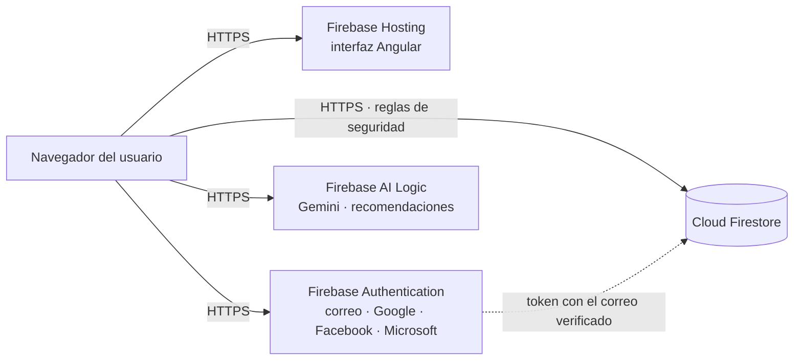

Implementación y administración en Firebase
===========================================

Esta guía describe cómo queda ICA Bienestar Animal en producción sobre Firebase, cómo se comunican sus componentes, cómo se configuran los servicios de autenticación e inteligencia artificial, cómo se protegen los datos y cómo se verifica cada publicación. Corresponde a la sección *Implementación y administración de servidores* de los requerimientos funcionales y técnicos.


Arquitectura
------------

Toda la plataforma vive en el proyecto de Firebase **bienestar-animal-ica**. No hay servidores propios que administrar: Google opera la infraestructura y el equipo administra la configuración, las reglas de seguridad y los datos.



| Servicio | Función | Configuración |
|---|---|---|
| Firebase Hosting | Sirve la interfaz compilada con HTTPS y certificado automático | `firebase.json` |
| Firebase Authentication | Identidad: correo y contraseña, Google, Facebook y Microsoft | Consola de Firebase |
| Cloud Firestore | Base de datos: usuarios, roles, catálogos, predios, evaluaciones, recomendaciones y bitácora | `firebase/firestore.rules`, `firebase/firestore.indexes.json` |
| Firebase AI Logic | Redacta las recomendaciones para el propietario con un modelo Gemini | Consola de Firebase y `modeloIA` en `frontend/src/environments/firebase.config.ts` |

La interfaz se comunica con cada servicio mediante el SDK web de Firebase. No existe una API intermedia: la seguridad de los datos la garantizan las **reglas de Firestore**, que se evalúan en los servidores de Google en cada lectura y escritura, sin importar desde dónde llegue la petición.


Autenticación y autorización
----------------------------

- **Autenticación.** Firebase Authentication confirma quién es la persona y entrega un token firmado con su identificador y su correo, e indica si el correo está verificado.
- **Autorización.** Lo que la persona puede hacer lo deciden su documento en `usuarios` (rol y estado) y la lista de permisos de su rol en `roles`. Las reglas de Firestore los consultan en cada operación, de modo que inactivar a alguien o cambiarle el rol surte efecto de inmediato, aunque tenga la sesión abierta.
- **Propietarios.** Una persona que se registra, o que ingresa por primera vez con Google, Facebook o Microsoft, recibe el rol Propietario. Ve solo los predios registrados con su correo, y solo después de verificarlo.


Configuración del proyecto en la consola de Firebase
----------------------------------------------------

Estos pasos se hacen una vez, en `console.firebase.google.com`, con una cuenta que tenga el rol de propietario o editor del proyecto.

**Authentication**

- En *Sign-in method*, dejar habilitado **Correo electrónico/contraseña** y habilitar **Google**. Para **Facebook** se registra una aplicación en developers.facebook.com y para **Microsoft** una en el portal de Azure (*App registrations*); en ambas se usa como dirección de retorno la que muestra Firebase al habilitar el proveedor. Los botones que muestra la aplicación se definen en `proveedores`, en `firebase.config.ts`.
- En *Settings*, *Password policy*, exigir al menos 10 caracteres y un número, igual que la aplicación.
- En *Settings*, *Authorized domains*, agregar el dominio de Hosting si se usa uno propio. `localhost` y los dominios `web.app` y `firebaseapp.com` del proyecto ya están autorizados.
- En *Templates*, poner el idioma en español. Los enlaces de verificación y de restablecimiento usan la página que ofrece Firebase.

**Firestore**

- La base ya está creada. Mientras esté en *modo de prueba*, **cualquiera que tenga la configuración web puede leer y modificar todos los datos**. Por eso, antes de registrar datos reales, se publican las reglas de este repositorio (ver *Publicación*).

**Firebase AI Logic**

- En *AI Logic*, seleccionar *Get started* y elegir **Gemini Developer API**, que funciona en el plan gratuito. La clave del modelo la administra Firebase y no se incluye en la aplicación.
- Se recomienda activar **App Check** con reCAPTCHA Enterprise para que solo la aplicación publicada pueda usar el modelo.
- Si AI Logic no está habilitado o no responde en 60 segundos, la aplicación genera las recomendaciones con reglas a partir de la norma y lo indica en el informe. La evaluación nunca se bloquea.

**Acceso del equipo**

- En *Configuración del proyecto*, *Usuarios y permisos*, se agrega el Gmail de cada integrante. Para administrar la configuración basta el rol **Editor**; el rol **Propietario** se reserva para quien responde por el proyecto.
- Esas cuentas son para administrar Firebase. Las cuentas para **usar** la aplicación se crean desde la pantalla *Usuarios* o con el registro de propietarios.


Credenciales
------------

| Dato | Dónde está | ¿Es secreto? |
|---|---|---|
| Configuración web (`apiKey`, `authDomain`, `projectId`…) | `frontend/src/environments/firebase.config.ts` | No. Identifica el proyecto y es público por diseño; la protección está en las reglas y en App Check |
| Cuenta de servicio (archivo JSON) | Solo en el equipo de quien ejecuta la semilla | **Sí**. Da acceso total al proyecto. Nunca se sube al repositorio ni se comparte por chat; `firebase/.gitignore` la excluye |
| Contraseña del administrador inicial | Variables `SEMILLA_ADMIN_CORREO` y `SEMILLA_ADMIN_CLAVE`, solo al ejecutar la semilla | **Sí**. Se cambia en el primer ingreso |
| Clave del modelo de IA | La administra Firebase AI Logic | No existe en la aplicación |

La cuenta de servicio se genera en *Configuración del proyecto*, *Cuentas de servicio*, *Generar nueva clave privada*. Al terminar de usarla, se recomienda borrar la clave desde la misma pantalla.


Publicación
-----------

Se necesita la herramienta de Firebase, que ya viene en `firebase/` (`npm install` en esa carpeta), y haber iniciado sesión una vez con `npx firebase login`.

**Reglas e índices de Firestore.** Se publican antes que nada, y siempre después de que pasen sus pruebas:

```
cd firebase
npm run test:reglas
npm run desplegar:reglas
```

**Datos iniciales.** La semilla crea o actualiza los roles base, las especies, las libertades, los niveles y los 23 criterios con sus indicadores, normaliza los usuarios creados con el formato anterior y crea el primer administrador. Se puede ejecutar varias veces sin duplicar nada. En PowerShell:

```powershell
cd firebase
$env:GOOGLE_APPLICATION_CREDENTIALS = "C:\ruta\cuenta-de-servicio.json"
$env:SEMILLA_ADMIN_CORREO = "correo-del-administrador@gmail.com"
$env:SEMILLA_ADMIN_CLAVE = "UnaClaveSegura2026"
npm.cmd run semilla
```

**Interfaz.** Se compila y se publica en Hosting:

```
cd frontend
npm run build
cd ../firebase
npm run desplegar:sitio
```

La aplicación queda en `https://bienestar-animal-ica.web.app`. Hosting sirve los archivos con HTTPS, caché larga para los archivos con huella y las cabeceras de seguridad definidas en `firebase.json`.


Seguridad
---------

| Capa | Medida |
|---|---|
| Transporte | HTTPS obligatorio en Hosting, Authentication, Firestore y AI Logic; HSTS en la interfaz |
| Identidad | Contraseñas administradas por Firebase con bloqueo ante intentos repetidos; verificación del correo para los propietarios; proveedores externos opcionales |
| Autorización | Reglas de Firestore por permiso del rol, evaluadas en el servidor en cada operación; usuarios y roles inactivos pierden el acceso de inmediato |
| Integridad | Validación de los datos en las reglas; una evaluación finalizada no se modifica; el nivel debe coincidir con el puntaje; las recomendaciones y la bitácora solo se agregan |
| Privacidad | El propietario solo ve sus predios; a la IA no se envían nombres, documentos, teléfonos ni correos |
| Trazabilidad | Colección `auditoria` de solo escritura para quien actúa y solo lectura para quien tiene `auditoria.ver` |
| Navegador | Cabeceras `X-Content-Type-Options`, `X-Frame-Options`, `Referrer-Policy` y `Strict-Transport-Security` en Hosting |

El cálculo del puntaje se hace en el navegador del evaluador. Las reglas verifican que el nivel corresponda al puntaje y que la evaluación no cambie después de finalizada; verificar el puntaje completo en el servidor requeriría Cloud Functions, que exige el plan de pago (Blaze).


Respaldos
---------

- **Plan Blaze.** Se programa un respaldo diario de Firestore con retención de una semana:

  ```
  gcloud firestore backups schedules create --database="(default)" --recurrence=daily --retention=7d
  ```

- **Plan gratuito (Spark).** No incluye respaldos administrados. Se recomienda exportar periódicamente las colecciones desde la consola o pasar a Blaze antes de cargar datos oficiales.

Los informes PDF no se guardan: se generan cada vez a partir de la evaluación finalizada, que no cambia, por lo que siempre salen iguales.


Pruebas de despliegue
---------------------

Antes de publicar, la integración continua (`.github/workflows/ci.yml`) ejecuta las pruebas de las reglas en el emulador, las pruebas unitarias de la interfaz, la compilación de producción y las pruebas de extremo a extremo con Playwright contra los emuladores de Auth y Firestore.

Después de publicar se hace esta verificación en `https://bienestar-animal-ica.web.app`:

| Prueba | Resultado esperado |
|---|---|
| Abrir la página de ingreso | Carga con HTTPS y sin errores en la consola del navegador |
| Ingresar como administrador | Abre la pantalla de inicio con todas las secciones |
| Crear un usuario evaluador | Le llega el correo para crear su contraseña |
| Como evaluador, registrar un predio y finalizar una evaluación | Muestra el nivel, las recomendaciones y descarga los dos PDF |
| Registrar un propietario con el correo del predio, verificarlo e ingresar | Ve solo ese predio y sus evaluaciones finalizadas |
| Con otro propietario, abrir la dirección de ese predio | Responde que el predio no existe |
| Revisar en la consola de Firestore la colección `auditoria` | Hay registros de la creación del usuario, del predio y de la evaluación, con quién los hizo |


Desarrollo sin tocar el proyecto real
-------------------------------------

Los emuladores de Firebase reproducen Authentication y Firestore en el propio equipo, con las mismas reglas. Requieren Java 21:

```
cd firebase
npm run emuladores
```

En otra terminal se cargan los datos y se inicia la interfaz conectada a los emuladores:

```
cd firebase
npm run semilla:emulador
cd ../frontend
npm run start:emuladores
```

La consola de los emuladores, en `http://localhost:4000`, muestra los usuarios, los documentos y los correos que se habrían enviado, con sus enlaces.
