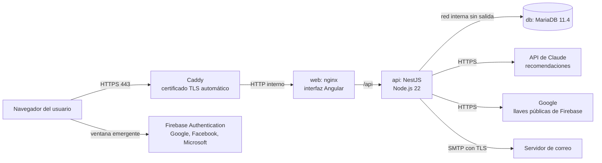

Implementación y administración del servidor
============================================

Esta guía describe cómo poner ICA Bienestar Animal en producción en un servidor propio, cómo se comunican sus componentes, cómo se protegen las credenciales y cómo se verifica cada despliegue. Corresponde a la sección *Implementación y administración de servidores* de los requerimientos funcionales y técnicos.


Arquitectura de despliegue
--------------------------

Todo el sistema se ejecuta en un único servidor Linux con Docker. Cada componente corre en su propio contenedor y solo Caddy recibe tráfico de internet.



| Componente | Imagen | Función | Puertos |
|---|---|---|---|
| `caddy` | `caddy:2.8` | Termina HTTPS, obtiene y renueva el certificado de Let's Encrypt, redirige HTTP a HTTPS | 80 y 443, públicos |
| `web` | `frontend/Dockerfile` | nginx sirve la interfaz compilada, agrega las cabeceras de seguridad y reenvía `/api` | 8080, solo red interna |
| `api` | `backend/Dockerfile` | Servicio de aplicación: autenticación, autorización, predios, evaluaciones, informes PDF, IA | 3000, solo red interna |
| `db` | `mariadb:11.4` | Base de datos con los volúmenes persistentes | 3306, solo red interna `datos` |

La red `datos` se declara como interna: la base de datos no tiene salida a internet y solo el servicio de aplicación la alcanza. Los archivos que definen este despliegue están en la carpeta [`despliegue/`](../despliegue).

| Archivo | Contenido |
|---|---|
| `docker-compose.servidor.yml` | Los cuatro servicios, sus redes y volúmenes |
| `Caddyfile` | Dominio y proxy hacia la interfaz |
| `.env.servidor.example` | Plantilla de variables y secretos |
| `respaldo.sh` | Respaldo comprimido de la base, con retención de 14 días |
| `verificar.sh` | Pruebas de humo posteriores a cada despliegue |


Requisitos del servidor
-----------------------

| Recurso | Mínimo | Recomendado |
|---|---|---|
| Sistema operativo | Ubuntu Server 24.04 LTS o Debian 12 | El mismo, con actualizaciones automáticas de seguridad |
| Procesador y memoria | 2 vCPU y 4 GB | 4 vCPU y 8 GB |
| Disco | 40 GB SSD | 80 GB SSD; los informes PDF se guardan en la base |
| Red | IP pública fija y un dominio con registro DNS tipo A hacia ella | El mismo |

Sirve cualquier máquina virtual de un proveedor de nube o un servidor de la entidad. MariaDB no se ofrece como servicio administrado en todas las nubes; por eso la base corre en el mismo servidor, con respaldos programados (ver *Respaldos*).


Preparación del servidor
------------------------

Los comandos se ejecutan una sola vez, con un usuario administrador distinto de `root`.

**Actualizar el sistema y activar las actualizaciones de seguridad**

```
sudo apt update && sudo apt upgrade -y
sudo apt install -y unattended-upgrades ufw fail2ban git netcat-openbsd
sudo dpkg-reconfigure -plow unattended-upgrades
```

**Cortafuegos: solo SSH, HTTP y HTTPS**

```
sudo ufw default deny incoming
sudo ufw allow OpenSSH
sudo ufw allow 80/tcp
sudo ufw allow 443/tcp
sudo ufw enable
```

**Acceso por SSH solo con llave.** En `/etc/ssh/sshd_config` se fijan `PasswordAuthentication no` y `PermitRootLogin no`, y se reinicia el servicio con `sudo systemctl restart ssh`. Fail2ban queda activo con su configuración por defecto, que bloquea las IP con intentos repetidos de acceso por SSH.

**Docker.** Se instala Docker Engine con el complemento Compose siguiendo la guía oficial para Ubuntu (docs.docker.com/engine/install/ubuntu) y se agrega el usuario al grupo `docker`.

**Código.** La aplicación se ubica en `/opt/ica-bienestar`:

```
sudo mkdir -p /opt/ica-bienestar && sudo chown $USER /opt/ica-bienestar
git clone https://github.com/98765432100123456/Aplicacion-a-la-inteligencia-artificial-.git /opt/ica-bienestar
```


Configuración y manejo de credenciales
--------------------------------------

Todas las credenciales viven en un único archivo, `despliegue/.env.servidor`, que solo puede leer el usuario que administra el servidor. El archivo está excluido de Git y nunca se copia al repositorio, a correos ni a chats (RNFG06).

```
cd /opt/ica-bienestar/despliegue
cp .env.servidor.example .env.servidor
chmod 600 .env.servidor
```

| Variable | Cómo se obtiene |
|---|---|
| `DOMINIO`, `CORS_ORIGINS`, `FRONTEND_URL` | El dominio público, con y sin `https://` según indica la plantilla |
| `DB_PASSWORD`, `DB_ROOT_PASSWORD` | `openssl rand -base64 32`, una distinta para cada una |
| `JWT_SECRET` | `openssl rand -base64 48`; si se cambia, todas las sesiones abiertas se cierran |
| `SMTP_*`, `MAIL_FROM` | Cuenta de correo institucional para envío; con `SMTP_SECURE` o el puerto 587 la conexión va cifrada |
| `SEED_ADMIN_EMAIL`, `SEED_ADMIN_PASSWORD` | Datos del primer administrador; se usan solo al sembrar la base |
| `ANTHROPIC_API_KEY` | Consola de Anthropic (console.anthropic.com), en *API Keys*; ver *Servicio de inteligencia artificial* |
| `FIREBASE_*` | Consola de Firebase; ver *Servicio de autenticación externa* |

Buenas prácticas para las credenciales:

- Cada ambiente (pruebas y producción) tiene sus propias claves; nunca se reutilizan las de desarrollo.
- Las claves se rotan al menos una vez al año y de inmediato si alguien con acceso deja el proyecto. Para rotar, se cambia el valor en `.env.servidor` y se ejecuta `docker compose ... up -d` (ver *Actualizaciones*).
- Si una clave se expone por error, se revoca en su consola de origen antes de reemplazarla.
- Para una operación más grande, el mismo archivo puede generarse desde un gestor de secretos (por ejemplo, Vault o el administrador de secretos del proveedor de nube) al momento del despliegue.


Primer despliegue
-----------------

```
cd /opt/ica-bienestar/despliegue
docker compose -f docker-compose.servidor.yml --env-file .env.servidor up -d --build
docker compose -f docker-compose.servidor.yml --env-file .env.servidor exec api node dist/database/seed.js
```

El primer comando construye las imágenes y arranca los cuatro servicios. Al iniciar, el servicio de aplicación aplica las migraciones pendientes (`DB_MIGRATIONS_RUN=true`), de modo que el esquema siempre coincide con el código. El segundo comando siembra los roles base (Administrador, Evaluador, Consultor, Propietario), las especies y el administrador inicial; puede repetirse sin duplicar datos.

Caddy solicita el certificado TLS en el primer acceso al dominio; para que lo obtenga, el registro DNS debe apuntar ya al servidor y los puertos 80 y 443 deben estar abiertos.

Al terminar, el administrador ingresa con el correo y la contraseña sembrados y la cambia de inmediato desde *Mi cuenta*.


Comunicación entre componentes
------------------------------

| Origen | Destino | Protocolo | Protección |
|---|---|---|---|
| Navegador | Caddy | HTTPS (TLS 1.2 o superior) | Certificado de Let's Encrypt; HTTP se redirige a HTTPS; cabecera HSTS |
| Caddy | nginx (`web`) | HTTP en la red interna de Docker | No sale del servidor |
| nginx | API | HTTP en la red interna, bajo la ruta `/api` | Interfaz y API comparten el dominio, sin exponer CORS a terceros |
| API | MariaDB | Protocolo de MariaDB en la red `datos`, marcada como interna | Usuario de base con permisos solo sobre `ica_bienestar`; sin puerto publicado |
| API | API de Claude | HTTPS | Clave en variable de entorno; no se envían datos personales |
| API | Google | HTTPS | Descarga de las llaves públicas para validar los tokens de Firebase |
| API | Servidor SMTP | SMTP con STARTTLS o TLS | Credenciales en variable de entorno |

La API sabe que va detrás de dos proxies (`TRUST_PROXY_HOPS=2`), por lo que el límite de intentos de ingreso se aplica por la IP real de cada persona.


Servicio de inteligencia artificial
-----------------------------------

Las recomendaciones para el propietario se generan con la API de Claude, de Anthropic, al finalizar cada evaluación.

- **Activación.** Se crea una clave en la consola de Anthropic, se define un límite de gasto mensual en la misma consola y se escribe en `ANTHROPIC_API_KEY`. El modelo se elige con `AI_MODEL`.
- **Privacidad.** A la IA solo se envían la especie, el tipo de productor, el municipio, los puntajes y los hallazgos. No se envían nombres, documentos, teléfonos ni correos.
- **Respaldo.** Si la clave no está configurada, si el servicio no responde en `AI_TIMEOUT_MS` o si la respuesta no es válida, el sistema genera las recomendaciones con reglas a partir de la norma y lo indica en el informe. Desde el resultado de la evaluación se pueden volver a generar con IA más adelante.
- **Aviso.** Todo informe de recomendaciones aclara que no reemplaza el concepto oficial del ICA.


Servicio de autenticación externa
---------------------------------

El ingreso con Google, Facebook y Microsoft usa Firebase Authentication. Firebase solo **autentica**: confirma quién es la persona. La **autorización**, es decir, qué puede ver y hacer, la decide siempre el sistema con el rol y los permisos guardados en MariaDB. Una cuenta nueva que ingresa por un proveedor externo recibe el rol Propietario, que solo consulta los predios registrados con su correo.

Pasos en la consola de Firebase (console.firebase.google.com):

- Crear un proyecto y, dentro de él, una aplicación web. De su configuración se copian `apiKey`, `authDomain` y `projectId` en `FIREBASE_API_KEY`, `FIREBASE_AUTH_DOMAIN` y `FIREBASE_PROJECT_ID`.
- En *Authentication*, pestaña *Sign-in method*, habilitar Google. Para Facebook se registra una aplicación en developers.facebook.com y para Microsoft una en el portal de Azure (*App registrations*); en ambas se usa como dirección de retorno la que muestra Firebase al habilitar el proveedor.
- En *Authentication*, pestaña *Settings*, agregar el dominio público a *Authorized domains*.
- `FIREBASE_PROVIDERS` lista los botones que se muestran; por ejemplo, `google,microsoft` oculta Facebook.

La API valida cada token con las llaves públicas de Google, el emisor y la audiencia del proyecto, y exige que el correo esté verificado. Sin `FIREBASE_PROJECT_ID`, los botones no aparecen y el ingreso es solo con correo y contraseña.


Seguridad
---------

| Capa | Medida |
|---|---|
| Red | Cortafuegos con solo los puertos 22, 80 y 443; SSH solo con llave; Fail2ban; base de datos sin puerto publicado |
| Transporte | HTTPS obligatorio con renovación automática; HSTS; conexiones salientes cifradas |
| Aplicación | Contraseñas con bcrypt; bloqueo temporal tras intentos fallidos; límite de peticiones por IP; tokens de sesión firmados con vencimiento; validación de toda entrada |
| Navegador | Política de seguridad de contenido, `X-Frame-Options`, `X-Content-Type-Options` y `Referrer-Policy` en nginx |
| Autorización | Permisos verificados en cada petición; el propietario solo ve sus predios y las evaluaciones finalizadas |
| Datos | Credenciales fuera del repositorio, con permisos 600; respaldos diarios; bitácora de auditoría |
| Contenedores | La API corre con un usuario sin privilegios; las imágenes se reconstruyen en cada actualización con los parches del sistema base |


Respaldos
---------

El script `respaldo.sh` genera un volcado consistente de la base (`--single-transaction`), lo comprime y borra los de más de 14 días. Se programa con `crontab -e`:

```
15 2 * * * /opt/ica-bienestar/despliegue/respaldo.sh >> /var/log/ica-respaldo.log 2>&1
```

Los respaldos quedan en `despliegue/respaldos/`. Se recomienda copiarlos fuera del servidor, por ejemplo a un almacenamiento de objetos con `rclone`, y probar una restauración al menos una vez por trimestre:

```
gunzip -c respaldos/ica_bienestar_FECHA.sql.gz | docker compose -f docker-compose.servidor.yml --env-file .env.servidor exec -T db sh -c 'mariadb -u root -p"$MARIADB_ROOT_PASSWORD" "$MARIADB_DATABASE"'
```


Pruebas de despliegue
---------------------

Después de cada despliegue se ejecutan las pruebas de humo:

```
./verificar.sh https://bienestar.ejemplo.gov.co
```

| Prueba | Qué confirma |
|---|---|
| La interfaz responde por HTTPS | Caddy, el certificado y nginx funcionan |
| El servicio de aplicación y la base responden | `/api/health` informa `"database":"up"` |
| La configuración de ingreso es pública | `/api/auth/config` atiende sin sesión |
| Las rutas protegidas exigen sesión | `/api/farms` sin token responde 401 |
| HTTP redirige a HTTPS | No hay tráfico sin cifrar |
| Se envía la política de seguridad de contenido | nginx aplica sus cabeceras |
| La base no está expuesta | El puerto 3306 no responde desde fuera |

Luego se hace una prueba funcional corta en el navegador: ingresar como administrador, registrar un predio de prueba, iniciar una evaluación, finalizarla y descargar los dos informes PDF. Si `ANTHROPIC_API_KEY` está configurada, el informe del propietario debe indicar que las recomendaciones se generaron con IA.

Antes de llegar al servidor, cada cambio pasa por la integración continua del repositorio (`.github/workflows/ci.yml`), que ejecuta la verificación de tipos, las pruebas unitarias y las pruebas de extremo a extremo de la API contra MariaDB, y compila la interfaz.


Operación diaria
----------------

| Tarea | Comando, desde `despliegue/` |
|---|---|
| Ver el estado de los servicios | `docker compose -f docker-compose.servidor.yml ps` |
| Ver los registros de la API | `docker compose -f docker-compose.servidor.yml logs -f api` |
| Reiniciar un servicio | `docker compose -f docker-compose.servidor.yml --env-file .env.servidor restart api` |
| Ver el uso de disco | `docker system df` y `df -h` |

**Actualizaciones.** Para publicar una versión nueva:

```
cd /opt/ica-bienestar
git pull
cd despliegue
./respaldo.sh
docker compose -f docker-compose.servidor.yml --env-file .env.servidor up -d --build
./verificar.sh https://bienestar.ejemplo.gov.co
docker image prune -f
```

Las migraciones nuevas se aplican solas al reiniciar la API. Si una versión presenta fallas, se vuelve a la anterior con `git checkout` de la etiqueta previa y el mismo `up -d --build`; si la versión fallida ya había migrado la base, se restaura el respaldo tomado antes de actualizar.


Desarrollo local con Docker
---------------------------

El archivo `docker-compose.yml` de la raíz levanta el mismo sistema sin Caddy ni HTTPS, con credenciales de desarrollo, para probar en un equipo local:

```
docker compose up --build
docker compose exec api node dist/database/seed.js
```

La interfaz queda en `http://localhost:8080`. Ese archivo nunca se usa en producción.
