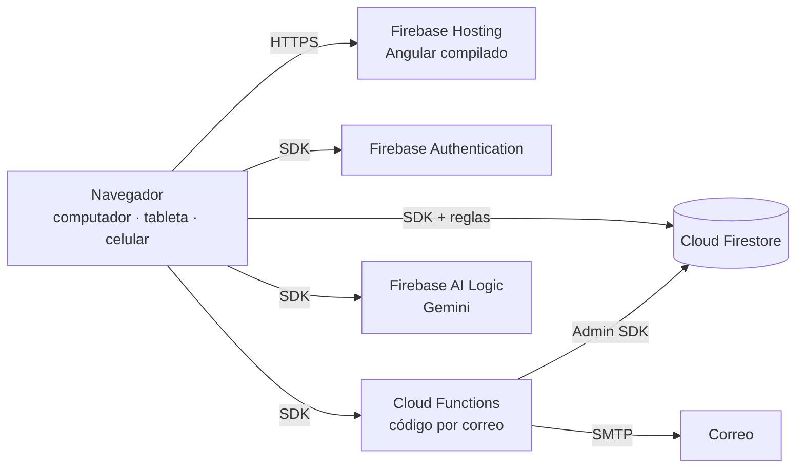
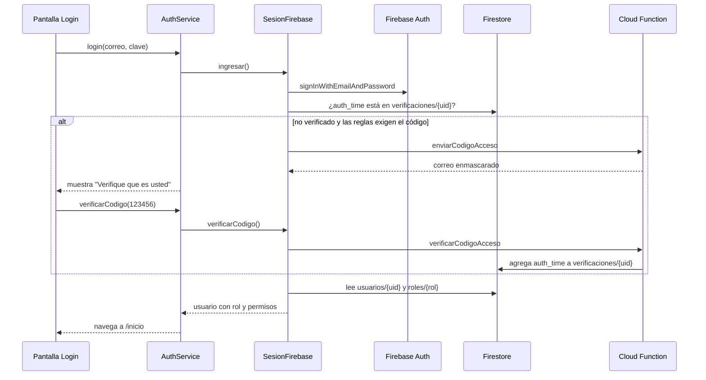

Informe técnico de ICA Bienestar Animal
=====================================

Documento de sustentación. Explica qué hace la aplicación, con qué lenguajes y tecnologías está hecha, para qué sirve cada parte del código, qué llama a qué, cómo se usa Firebase, qué puede hacer cada rol, cómo se calcula la evaluación, cómo se protege y cómo se prueba y se publica.

Proyecto de la asignatura Aplicación a la Inteligencia Artificial, basado en el documento *Requerimientos funcionales Aplicación ICA – Bienestar Animal* de la PhD. Paola Andrea Valencia A., y en la *Metodología para evaluar el bienestar animal en las especies bovina y bufalina* del ICA (versión 2.0, 2023).

Repositorio: `98765432100123456/Aplicacion-a-la-inteligencia-artificial-`, rama `main`. Sitio: `https://bienestar-animal-ica.web.app`. Corte de este informe: commit `82a12f7`, 17 de noviembre de 2026.


1. Qué es y qué problema resuelve
---------------------------------

El ICA evalúa el bienestar de bovinos y búfalos con una lista de chequeo en papel: 23 criterios agrupados en las cinco libertades del bienestar animal, con árboles de decisión ("árbol de escenarios") que suman puntos. Hacerlo a mano en campo es lento, se presta a errores de suma y el propietario recibe un informe técnico que no entiende.

ICA Bienestar Animal lleva ese proceso a una aplicación web que funciona en computador, tableta y celular:

1. El **evaluador** registra el predio y su inventario. La aplicación calcula el tipo de productor y cuántos animales revisar.
2. Diligencia la evaluación con listas desplegables que siguen exactamente los diagramas del ICA. Los puntos se suman solos y se recalculan si cambia una respuesta. Todo se guarda automáticamente.
3. Al finalizar, la aplicación calcula el puntaje de 0 a 5, el nivel (Bajo, Medio, Alto, Excelente) y los hallazgos.
4. La **inteligencia artificial** (Gemini) redacta recomendaciones en lenguaje sencillo; si no está disponible, se usan recomendaciones por reglas.
5. Se generan dos PDF: el **informe técnico** y el **informe para el propietario**.
6. El **propietario** entra con su correo y ve solo sus predios, sus resultados y qué mejorar.


2. Lenguajes y tecnologías
--------------------------

| Lenguaje | Dónde se usa | Para qué | Líneas aprox. |
|---|---|---|---|
| **TypeScript** | `frontend/src`, `compartido/`, `firebase/` | Toda la lógica: pantallas, servicios, cálculo de la norma, Cloud Functions, pruebas | 10 000 (más 1 850 de `compartido/`) |
| **HTML** (plantillas de Angular) | Un `.html` por componente | Estructura de cada pantalla, con la sintaxis de control `@if`, `@for` | 2 850 |
| **SCSS** (CSS con variables y anidación) | Un `.scss` por componente y `src/styles/` | Diseño visual, modo oscuro, adaptación a celular | 2 700 |
| **Reglas de seguridad de Firestore** (lenguaje propio de Google) | `firebase/firestore.rules` | Quién puede leer y escribir cada documento | 175 |
| **JavaScript (módulos de Node, `.mjs`)** | `scripts/` | Control de seguridad, copia del código compartido, versión, publicación | 3 700 (incluye generadores de documentos) |
| **YAML** | `.github/workflows/ci.yml`, `.github/dependabot.yml` | Integración y publicación continuas | — |
| **JSON** | `firebase.json`, `angular.json`, `package.json` | Configuración | — |
| **Markdown y Mermaid** | `docs/` | Documentación y diagramas | — |

| Tecnología | Versión | Rol en el proyecto |
|---|---|---|
| Angular | 20.3 | Marco de la interfaz: componentes independientes, señales, detección de cambios sin Zone.js, carga diferida por ruta |
| RxJS | 7.8 | Flujos asíncronos de los servicios (`Observable`) |
| Firebase JS SDK | 13.3 | Authentication, Firestore, Functions y AI Logic desde el navegador |
| Firebase Admin SDK | 14.5 | Semilla de datos y Cloud Functions (permisos de administrador) |
| Cloud Functions (2.ª generación) | `firebase-functions` 7.4, Node 22 | Código de verificación en dos pasos por correo |
| Nodemailer | 10.5 | Envío del correo con el código |
| Firebase AI Logic (Gemini 2.5 Flash) | — | Recomendaciones y asistente Clara |
| pdfmake | 0.3 | Informes PDF generados en el navegador |
| Karma + Jasmine | 6.4 / 5.9 | Pruebas unitarias |
| Playwright + axe-core | 1.56 / 4.13 | Pruebas de extremo a extremo y de accesibilidad |
| `@firebase/rules-unit-testing` | 6.0 | Pruebas de las reglas en el emulador |
| Firebase Emulator Suite | `firebase-tools` 15.36 | Auth, Firestore y Functions locales para pruebas |
| GitHub Actions | — | Integración continua y publicación automática |


3. Estructura del repositorio
-----------------------------

```
├── compartido/            Reglas del negocio escritas una sola vez (norma ICA, cálculo, IA, permisos, PDF)
├── frontend/              Aplicación web Angular
│   ├── src/app/
│   │   ├── core/          Servicios, conexión con Firebase, modo demostración, guardas, utilidades
│   │   ├── features/      Pantallas por funcionalidad (ingreso, predios, evaluaciones, usuarios, roles…)
│   │   ├── layout/        Estructura común (barra superior, menú, pie)
│   │   ├── shared/        Componentes reutilizables (diálogo, avisos, esqueleto de carga…)
│   │   └── compartido/    Copia generada de /compartido (no se edita a mano)
│   ├── src/styles/        Variables de diseño (colores, tipografía, espacio, modo oscuro)
│   ├── src/environments/  Configuración por ambiente (producción, desarrollo, emuladores, demo, vista)
│   ├── public/            Fotos, favicon, robots.txt, security.txt, tema.js
│   └── e2e/               Pruebas de extremo a extremo con Playwright
├── firebase/
│   ├── firestore.rules    Reglas de seguridad (la frontera de seguridad real)
│   ├── funciones/         Cloud Functions de la verificación en dos pasos
│   ├── pruebas/           Pruebas de las reglas
│   ├── semilla.ts         Carga inicial: roles, especies, libertades, niveles, 23 criterios, administrador
│   └── compartido/        Copia generada de /compartido
├── scripts/               Control de seguridad, copia de compartido, versión, vista previa, publicación
├── docs/                  Arquitectura, manuales, base de datos, UML, seguridad, despliegue
├── firebase.json          Hosting (cabeceras de seguridad, caché), Firestore, Functions, emuladores
└── .github/               Integración continua (ci.yml) y Dependabot
```


4. Arquitectura
---------------



**Decisión principal: no hay servidor propio.** La aplicación Angular habla directamente con los servicios de Firebase. Esto elimina un servidor que mantener, actualizar y pagar, y quita una capa donde podían aparecer vulnerabilidades. La seguridad no depende de la interfaz (que un atacante puede modificar) sino de las **reglas de Firestore**, que Google evalúa en su servidor en cada lectura y escritura.

**Patrón de fachada con dos implementaciones.** Las pantallas nunca llaman a Firebase directamente. Llaman a tres servicios (fachadas), que deciden a quién delegar según el ambiente:

| Fachada | Con Firebase (uso real) | En modo demostración |
|---|---|---|
| `AuthService` | `SesionFirebase` (`core/services/sesion/sesion-firebase.ts`) | `SesionDemo`, contra una API simulada |
| `ApiService` (usuarios y roles) | `UsuariosRolesFirebase` (`core/firebase/usuarios-roles.ts`) | Peticiones HTTP a `/api` que responde `core/demo/demo-api.interceptor.ts` desde `localStorage` |
| `FarmsApiService` (predios, evaluaciones, informes) | `PrediosEvaluacionesFirebase` (`core/firebase/predios-evaluaciones.ts`) | Igual, con `core/demo/rutas/` |

Así la misma aplicación funciona contra Firebase real, contra los emuladores locales (para pruebas) y sin Firebase (demostración), sin cambiar una línea de las pantallas.

**Código compartido.** La norma del ICA, el cálculo, los permisos, las instrucciones de la IA y las plantillas de los PDF están en `compartido/` y los usan tanto el navegador como las herramientas de Firebase. `scripts/compartido.mjs` los copia a cada lado, y la integración continua falla si una copia quedó desactualizada: una sola fuente de verdad.


5. Qué llama a qué: los flujos principales
------------------------------------------

### 5.1 Arranque de la aplicación

```
index.html ─► tema.js (aplica modo claro u oscuro antes de pintar)
          └► main.ts ─► app.config.ts (proveedores: rutas, HTTP, idioma es-CO, manejador de errores)
                       └► App (app.ts / app.html)
                            ├► <router-outlet> ─► app.routes.ts (carga cada pantalla bajo demanda)
                            ├► app-toasts          (mensajes breves)
                            ├► app-aviso-cookies   (primera visita)
                            └► app-aviso-actualizacion ─► ActualizacionService (revisa /version.json)
```

Las rutas internas pasan por `authGuard` (exige sesión) y `permissionGuard` (exige el permiso de `route.data.permissions`). Las internas se dibujan dentro de `Shell` (`layout/shell`), que pone la barra superior, el menú según los permisos, el asistente Clara, el pie legal y el cierre por inactividad (`InactividadService`).

### 5.2 Ingreso con verificación en dos pasos



- `features/auth/login` llama a `AuthService.login()`.
- `AuthService` delega en `SesionFirebase.ingresar()`, que inicia sesión en Firebase Authentication y llama a `siguientePaso()`.
- `verificada()` revisa si ese inicio de sesión ya está verificado. Si las reglas publicadas aún no exigen el código, entra directo (así el sitio nuevo convive con reglas anteriores).
- Si falta el código, `llamarFuncion('enviarCodigoAcceso')` (`core/firebase/conexion.ts`) invoca la Cloud Function, y `AuthService.desafio` hace que la pantalla muestre `verificacion-codigo`.
- `sesionDe()` lee `usuarios/{uid}` y `roles/{rol}` para armar el usuario con sus permisos. `observar()` escucha esos dos documentos: si el administrador cambia el rol o inactiva a la persona, la sesión se actualiza o se cierra al instante.

### 5.3 Predios

```
farms-page ─► FarmsApiService.listFarms() ─► PrediosEvaluacionesFirebase.listFarms() ─► Firestore "predios"
farm-create ─► farm-form ─► FarmsApiService.createFarm() ─► … ─► Firestore (reglas validan los campos)
farm-detail ─► getFarm() + history() ─► predio, evaluaciones e informes del predio
```

El propietario solo recibe los predios cuyo `propietarioCorreo` es su correo verificado: la consulta filtra por correo y, además, las reglas rechazan cualquier otra lectura.

### 5.4 Evaluación

```
farm-detail "Realizar evaluación" ─► startEvaluation() ─► crea evaluaciones/{id} en estado "borrador"
evaluation-page ─► evaluation-form
   ├► listaPara(especie, sistema, total)       (compartido/lista-chequeo.ts: criterios que aplican)
   ├► arbol-escenario (por cada árbol del ICA) ─► recorrerArbol() suma los puntos paso a paso
   ├► respuestas por indicador (Cumple / Parcial / No cumple / No aplica)
   └► guardado automático ─► saveEvaluation() ─► Firestore (rutaLimpia descarta respuestas fuera del camino)
"Finalizar" ─► finalize()
   ├► faltantes()                 ¿falta algo por responder?
   ├► calificar()                 puntaje por libertad, total, nivel y hallazgos (compartido/calificacion.ts)
   ├► recomendarConIA()           Gemini con instrucciones y esquema JSON (core/firebase/ia.ts)
   │     └► validarSalidaIA()     descarta respuestas mal formadas
   ├► recomendacionesPorReglas()  respaldo si la IA no responde (compartido/recomendaciones.ts)
   └► guarda estado "finalizada" + recomendaciones + bitácora de auditoría (en un solo lote)
evaluation-result ─► muestra puntaje, libertades, hallazgos y recomendaciones
```

### 5.5 Informes PDF

```
farm-detail / evaluation-result ─► FarmsApiService.downloadReport(id, 'tecnico' | 'propietario')
   └► core/informes/informes.ts ─► compartido/informes.ts (informeTecnico / informePropietario)
         └► pdfmake genera el PDF en el navegador y lo descarga
```

Los PDF no se guardan en ningún servidor: se generan cada vez desde la evaluación finalizada, que ya no cambia, así que siempre salen iguales.

### 5.6 Asistente Clara

```
Shell ─► app-asistente (features/asistente/asistente)
   ├► preguntasPara(permisos)   preguntas sugeridas según el rol (preguntas.ts)
   ├► pregunta elegida ─► respuesta establecida (construida con los datos de compartido/norma.ts)
   └► pregunta escrita ─► responderConIA() (Gemini, limitado a la base de conocimiento)
                          └► si falla ─► buscarRespuesta() por palabras clave
```

### 5.7 Actualización en vivo

```
npm run build ─► scripts/version.mjs escribe version.json ─► scripts/control-seguridad.mjs --dist
GitHub Actions (main) ─► publica funciones, sitio y reglas
Página abierta ─► ActualizacionService cada 5 min ─► versión distinta ─► recarga sola
```


6. Código compartido (`compartido/`)
------------------------------------

| Archivo | Contenido | Lo usan |
|---|---|---|
| `norma.ts` | Las 4 libertades con sus pesos (20, 50, 15, 15 %), los 4 niveles, tipo de productor, tamaño del predio, muestra mínima y reparto por edades | Formularios, cálculo, guía de inicio, asistente, informes |
| `lista-chequeo.ts` | Los 23 criterios con sus indicadores, tipo de respuesta, método, peso y si son críticos; `listaPara()` filtra por especie, sistema productivo y tamaño | Evaluación, semilla, informes |
| `escenarios.ts` | Los 18 árboles de escenarios del ICA (diagramas 1 a 19) con sus preguntas, opciones, puntos y cortes de nivel; `recorrerArbol()`, `rutaLimpia()`, `nivelArbol()` | Evaluación, cálculo, informes |
| `calificacion.ts` | `calificar()`: puntaje por libertad, total, nivel, hallazgos; `faltantes()` | Finalización, informes |
| `recomendaciones.ts` | Recomendaciones por reglas cuando la IA no está disponible | Finalización |
| `ia.ts` | Instrucciones para Gemini, esquema JSON de la respuesta, datos sin información personal, `validarSalidaIA()` | Recomendaciones con IA |
| `permisos.ts` | Catálogo de 13 permisos y los 4 roles base | Reglas (mismo listado), semilla, menú, guardas |
| `informes.ts` | Plantillas pdfmake del informe técnico y del informe del propietario | Descarga de PDF |


7. Firebase
-----------

### 7.1 Servicios usados

| Servicio | Para qué | Configuración |
|---|---|---|
| **Authentication** | Identidad: correo y contraseña, Google, Facebook y Microsoft; verificación del correo y restablecimiento de contraseña | Consola de Firebase; `firebase.config.ts` define los botones |
| **Cloud Firestore** | Base de datos NoSQL de documentos | `firebase/firestore.rules`, `firestore.indexes.json` |
| **Cloud Functions** | Generar, enviar y verificar el código de 6 dígitos | `firebase/funciones/src/index.ts` |
| **AI Logic** | Gemini para recomendaciones y asistente, sin exponer la clave del modelo | `modeloIA` en `firebase.config.ts` |
| **Hosting** | Sirve la aplicación con HTTPS y cabeceras de seguridad | `firebase.json` |
| **Emulator Suite** | Auth, Firestore y Functions locales para desarrollo y pruebas | `firebase.json › emulators` |

### 7.2 Colecciones de Firestore

| Colección | Contenido | Quién la escribe |
|---|---|---|
| `usuarios/{uid}` | Nombres, correo, documento, teléfono, rol, activo, último ingreso | El administrador; cada persona solo su `ultimoIngreso`; el propietario se crea a sí mismo |
| `roles/{rol}` | Nombre, descripción, lista de permisos, activo, si es base | Quien tiene `roles.gestionar` |
| `especies`, `libertades`, `niveles`, `criterios` | Catálogos de la norma | Quien tiene `parametrizacion.gestionar` (y la semilla) |
| `predios/{id}` | Ubicación, propietario, sistema productivo, especies e inventario por edad | Quien tiene `fincas.gestionar` |
| `evaluaciones/{id}` | Respuestas, rutas de los árboles, estado, puntaje, nivel, resultado, recomendación | Quien tiene `evaluaciones.diligenciar` (finalizada = inmutable) |
| `recomendaciones/{id}` | Historial de recomendaciones de IA por evaluación | Al finalizar o regenerar |
| `auditoria/{id}` | Bitácora: quién hizo qué y cuándo (solo se agregan entradas) | La aplicación y las Cloud Functions |
| `verificaciones/{uid}` | Inicios de sesión verificados con el código | Solo la Cloud Function |
| `codigosAcceso/{uid}` | Resumen SHA-256 de los códigos pendientes | Solo la Cloud Function; nadie la lee desde la aplicación |

El detalle de cada campo está en `docs/base-de-datos/DICCIONARIO-DE-DATOS.md`.

### 7.3 Reglas de seguridad: cómo deciden

Las reglas son funciones que se evalúan en el servidor de Google en cada operación:

```
sesion()      = hay token  Y  dosPasos()            (inicio de sesión verificado y de menos de 12 horas)
activo()      = sesion()  Y  usuarios/{uid}.activo  Y  roles/{rol}.activo
puede(p)      = activo()  Y  el rol tiene alguno de los permisos p
esPropietarioDe(d) = puede('predios.propios')  Y  correo verificado  Y  d.propietarioCorreo == correo del token
```

Además validan la forma de los datos (tipos, longitudes, valores permitidos), impiden que alguien cambie su propio rol o se inactive, impiden editar una evaluación finalizada (salvo regenerar recomendaciones) y comprueban que el nivel guardado corresponda al puntaje (con números decimales, porque el lenguaje de reglas divide enteros sin decimales).

### 7.4 Cloud Functions

| Función | Qué hace | Controles |
|---|---|---|
| `enviarCodigoAcceso` | Genera un código aleatorio de 6 dígitos (`crypto.randomInt`), guarda su resumen SHA-256 con sal (uid y momento del ingreso) y lo envía por correo con Nodemailer | Vence en 10 min; reenvío cada 60 s; máximo 5 envíos por hora; contraseña del correo en Secret Manager |
| `verificarCodigoAcceso` | Compara el código en tiempo constante (`timingSafeEqual`) y, si es correcto, registra la sesión en `verificaciones/{uid}` | 5 intentos por código; registra `seguridad.codigo_bloqueado` y `seguridad.sesion_verificada` en la bitácora |

### 7.5 Hosting

`firebase.json` define: reescritura de todas las rutas a `index.html` (aplicación de una sola página), URL limpias, caché larga solo para archivos con huella, revalidación de `index.html` y `version.json`, y las cabeceras de seguridad: política de seguridad de contenido (CSP) sin scripts en línea, HSTS de 2 años, `X-Frame-Options: DENY`, `nosniff`, `Referrer-Policy`, `Permissions-Policy` y `Cross-Origin-Opener-Policy`.

### 7.6 Semilla

`firebase/semilla.ts` (Admin SDK) carga los 4 roles base, las especies, las 4 libertades, los 4 niveles, los 23 criterios con sus indicadores y el primer administrador. Se puede ejecutar varias veces sin duplicar.


8. Roles y permisos
-------------------

### 8.1 Los 13 permisos

| Módulo | Permiso | Permite |
|---|---|---|
| Seguridad | `usuarios.ver` | Consultar usuarios |
| | `usuarios.gestionar` | Crear, editar, activar e inactivar usuarios |
| | `roles.ver` | Consultar roles |
| | `roles.gestionar` | Crear y editar roles y sus permisos |
| Fincas | `fincas.ver` | Consultar todos los predios |
| | `fincas.gestionar` | Registrar y editar predios e inventario |
| | `predios.propios` | Consultar sus propios predios, evaluaciones e informes |
| Parametrización | `parametrizacion.gestionar` | Configurar especies, criterios y ponderaciones |
| Evaluación | `evaluaciones.ver` | Consultar evaluaciones y resultados |
| | `evaluaciones.diligenciar` | Crear y diligenciar evaluaciones |
| | `evaluaciones.validar` | Validar y cerrar evaluaciones |
| Reportes | `reportes.ver` | Ver y descargar reportes |
| Administración | `auditoria.ver` | Consultar la bitácora de auditoría |

### 8.2 Los cuatro roles base

| Rol | Permisos | Qué ve en el menú | Qué puede hacer |
|---|---|---|---|
| **Administrador** | Los 13 | Inicio, Predios, Usuarios, Roles, Diseño, Cuenta | Todo: gestionar usuarios y roles, predios, evaluaciones, catálogos y ver la bitácora. Nunca pierde permisos (las reglas lo impiden) |
| **Evaluador** | `fincas.ver`, `fincas.gestionar`, `evaluaciones.ver`, `evaluaciones.diligenciar`, `reportes.ver` | Inicio, Predios, Cuenta | Registrar y editar predios, realizar y finalizar evaluaciones, descargar informes |
| **Consultor externo** | `fincas.ver`, `evaluaciones.ver`, `reportes.ver` | Inicio, Predios, Cuenta | Consultar predios, evaluaciones e informes sin modificar nada |
| **Propietario del predio** | `predios.propios` | Inicio, Mis predios, Cuenta | Ver solo los predios registrados con su correo verificado, sus evaluaciones finalizadas, recomendaciones e informe para el propietario |

El administrador puede crear roles nuevos combinando permisos. Los roles base no se eliminan ni se inactivan, y nadie puede cambiar su propio rol.

### 8.3 Dónde se aplican

| Capa | Mecanismo | Si alguien la salta |
|---|---|---|
| Menú y botones | `AuthService.can(...)` oculta lo que el rol no puede usar | No gana nada: las reglas siguen bloqueando |
| Rutas | `permissionGuard` con `data.permissions` en `app.routes.ts` | Igual |
| **Datos** | **Reglas de Firestore** (`puede()`, `esPropietarioDe()`) | Es la frontera real: se evalúa en el servidor |


9. Método de calificación (norma del ICA)
-----------------------------------------

| Concepto | Regla | Dónde |
|---|---|---|
| Libertades y pesos | Alimento y agua 20 %, Salud 50 %, Confort 15 %, Comportamiento 15 % | `LIBERTADES` |
| Escala de niveles | Bajo < 3,0; Medio 3,0–3,9; Alto 4,0–4,5; Excelente 4,6–5,0 (puntaje redondeado a un decimal) | `NIVELES`, `nivelDePuntaje()` |
| Tipo de productor | Pequeño ≤ 50 animales; Mediano ≤ 500; Grande > 500 | `tipoProductor()` |
| Criterios que aplican | Según sistema productivo (lechería, carne, doble propósito) y tamaño (registros y medicamentos solo para medianos y grandes) | `listaPara()` |
| Muestra mínima | 20 animales hasta 99 (o todos si son menos de 20); 30 hasta 499; 40 hasta 999; 5 % desde 1 000; repartida por edades con el método del mayor residuo | `muestraMinima()`, `repartir()` |
| Árbol de escenarios | Cada respuesta suma los puntos del diagrama y decide la pregunta siguiente; los cortes del árbol dan su nivel | `escenarios.ts` |
| Indicadores | Cumple = 1, Cumple en parte = 0,5, No cumple = 0, No aplica se retira | `VALOR_RESPUESTA` |

**Fórmula.** Dentro de cada libertad:

```
puntaje_libertad = 5 × Σ(valor_i × peso_i) / Σ(peso_i)
```

donde cada indicador aporta su valor (1, 0,5 o 0) y cada árbol aporta `puntos / máximo` con el peso de los indicadores de su criterio. El total es el promedio de las libertades ponderado por 20/50/15/15, sobre las libertades que tienen datos. Los indicadores o árboles en nivel Medio o Bajo se convierten en **hallazgos**, ordenados primero los críticos.

La correspondencia con los diagramas del ICA se comprueba hoja por hoja en `core/norma/escenarios.spec.ts`.


10. Inteligencia artificial
---------------------------

### 10.1 Recomendaciones para el propietario

- **Modelo:** Gemini 2.5 Flash a través de **Firebase AI Logic**: la clave del modelo la administra Firebase y no viaja en la aplicación.
- **Entrada:** especie, tipo de productor, municipio y los hallazgos. **Nunca** nombres, documentos, teléfonos ni correos (`datosParaIA()`).
- **Instrucciones** (`INSTRUCCIONES_IA`): asesor de bienestar animal que escribe para propietarios en Colombia, lenguaje sencillo, acciones concretas, sin inventar normas.
- **Salida estructurada:** se exige un JSON con un esquema (`ESQUEMA_IA`: resumen y recomendaciones con prioridad, acción y motivo).
- **Validación:** `validarSalidaIA()` revisa tipos, longitudes y prioridades; si algo no cumple, se descarta.
- **Respaldo:** si la IA no está habilitada, falla, tarda más de 60 segundos o responde algo inválido, `recomendacionesPorReglas()` genera las recomendaciones desde la norma. La evaluación nunca se bloquea y el informe indica el origen.

### 10.2 Asistente Clara

Botón flotante con una mascota animada (SVG y CSS) que abre un panel pequeño:

- **13 preguntas establecidas**, sugeridas según el rol. Sus respuestas usan los mismos datos de la norma (pesos, niveles, muestra), así que no se desactualizan.
- **Pregunta libre** respondida por Gemini, con instrucciones que lo limitan a la aplicación y al bienestar animal, en máximo 90 palabras, sin pedir datos personales ni dar diagnósticos veterinarios.
- **Respaldo:** si la IA no está disponible, busca la respuesta establecida por palabras clave.
- **Límites:** 30 preguntas libres por sesión y 2 segundos entre ellas, para no agotar la cuota.


11. Seguridad
-------------

Resumen; el informe completo está en `docs/SEGURIDAD.md` (modelo de amenazas, OWASP Top 10, hallazgos, respuesta a incidentes).

| Capa | Controles |
|---|---|
| Identidad | Firebase Authentication; verificación en dos pasos por correo; bloqueo ante intentos repetidos; mensajes que no revelan si un correo existe |
| Sesión | Por pestaña; cierre tras 30 min sin actividad; máximo 12 horas en el servidor; revocación inmediata al inactivar |
| Autorización | Reglas de Firestore por permiso y propietario, con 16 pruebas automáticas |
| Navegador | CSP sin scripts en línea, HSTS, protección contra incrustación (clickjacking), sin `innerHTML` ni `eval` |
| Código | Control de seguridad automático (`scripts/control-seguridad.mjs`) que detiene la compilación si encuentra secretos, APIs peligrosas, cabeceras débiles o reglas abiertas |
| Dependencias | `npm audit` en la CI (0 vulnerabilidades en producción), Dependabot semanal |
| Privacidad | Ley 1581 de 2012: política de datos, términos y cookies; solo cookies esenciales; la IA no recibe datos personales |


12. Calidad y pruebas
---------------------

| Tipo | Herramienta | Qué cubre | Resultado |
|---|---|---|---|
| Reglas de Firestore | `@firebase/rules-unit-testing` en el emulador | Acceso por rol, propietario, dos pasos, vencimiento de sesión, evaluaciones finalizadas | **16 de 16 pasan** |
| Unitarias | Karma + Jasmine | Árboles de escenarios hoja por hoja, lista de chequeo, norma, sesión, verificación, preguntas del asistente, redirecciones, errores, actualización | **45 de 45 pasan** |
| Extremo a extremo | Playwright (escritorio 1440 px y celular Pixel 7) | Ingreso con código, gestión de usuarios y roles, predio → evaluación → finalizar → informes, asistente, páginas legales, actualización en vivo, regresión de seguridad | **69 de 69 pasan** |
| Accesibilidad | axe-core en cada pantalla de las pruebas | WCAG 2.1 A y AA, objetivos táctiles ≥ 44 px, sin desplazamiento horizontal | Incluida en las anteriores |
| Seguridad | `scripts/control-seguridad.mjs`, búsqueda de secretos en el historial, `npm audit` | Sección 11 | Sin hallazgos |

La integración continua (`.github/workflows/ci.yml`) ejecuta en cada cambio los trabajos `seguridad`, `reglas`, `interfaz` (pruebas unitarias y compilación) y `extremo-a-extremo`; en `main`, además, `publicar`.


13. Publicación y actualización en vivo
---------------------------------------

1. Cada cambio en `main` que pasa las cuatro suites se publica solo (trabajo `publicar`): Cloud Functions, sitio y reglas, en ese orden seguro. Requiere el secreto `FIREBASE_CUENTA_SERVICIO` en GitHub.
2. Cada compilación escribe `version.json`.
3. La página abierta revisa esa versión cada 5 minutos y al volver a la pestaña; si cambió, **se recarga sola** (si la persona está escribiendo, espera a que termine).
4. Si alguien abre una pantalla de la versión anterior que ya no existe, la aplicación recarga esa página con la versión nueva.


14. Interfaz y experiencia de uso
---------------------------------

- **Angular moderno:** componentes independientes (sin módulos), señales (`signal`, `computed`), detección de cambios sin Zone.js y carga diferida de cada pantalla.
- **Un componente por carpeta** con `.ts`, `.html` y `.scss` separados.
- **Sistema de diseño:** colores, tipografía (Manrope y Unbounded), espacios y movimientos como variables en `src/styles/_tokens.scss`; página `/sistema-de-diseno` con todos los elementos en vivo.
- **Modo oscuro** que sigue al sistema o a la elección de la persona; contraste aumentado.
- **Pensado para campo:** guardado automático, aviso sin conexión, siluetas de carga, errores con botón de reintento, objetivos táctiles grandes, funciona en celular y tableta.
- **Accesibilidad:** navegación con teclado, lectores de pantalla, `prefers-reduced-motion`, verificada con axe en las pruebas.
- **Guías de diseño de Apple (HIG):** revisión documentada en `docs/REVISION-APPLE-HIG.md`.


15. Evolución del proyecto
--------------------------

| Fecha | Etapa |
|---|---|
| 14 oct 2026 | Servicio propio en **NestJS** con PostgreSQL y frontend Angular; guías de Apple |
| 15–17 oct | Modo demostración, rediseño visual, diagramas UML y diseño de base de datos (entrega de la semana 12) |
| 27 oct | Migración a **MariaDB**; predios, evaluaciones, IA y PDF; luego **migración completa a Firebase** (Firestore, Authentication, reglas) y retiro del servicio NestJS |
| 28–30 oct | Guía de instalación en Windows, modo oscuro, fotografías, sistema de diseño, estados de carga y error |
| 7 nov | Evaluación con los **árboles de escenarios** del ICA |
| 14 nov | Asistente Clara, **verificación en dos pasos**, sitio público (privacidad, términos, cookies), estándares de ciberseguridad |
| 15 nov | Publicación automática y **actualización en vivo** |

La migración a Firebase se decidió porque eliminaba el servidor y la base de datos que había que administrar, daba autenticación con proveedores externos y reglas de seguridad evaluadas en el servidor, y permitía publicar gratis con HTTPS.


16. Limitaciones y trabajo futuro
---------------------------------

| Limitación | Por qué | Cómo se resuelve |
|---|---|---|
| La verificación en dos pasos aún no está activa en producción | Cloud Functions exige el plan Blaze (pago por uso, con cuota gratuita) | Activar Blaze, guardar los secretos del correo y publicar funciones y reglas (`docs/DESPLIEGUE.md`) |
| El puntaje se calcula en el navegador | Recalcularlo en el servidor exige Cloud Functions; las reglas sí verifican que el nivel corresponda al puntaje y que nada cambie después de finalizar | Mover `calificar()` a una Cloud Function |
| Sin App Check | Requiere configurar reCAPTCHA Enterprise en la consola | Activarlo para Firestore, Functions y AI Logic |
| Solo bovinos y búfalos | Es la norma disponible | La lista de chequeo está separada por especie (`LISTAS_POR_ESPECIE`) para agregar otras |
| La CSP permite estilos en línea | Angular inserta los estilos de cada componente | Riesgo aceptado: los scripts sí están bloqueados |
| Sin uso sin conexión completo | La evaluación necesita conexión para guardar | Firestore con persistencia local y un service worker |


17. Glosario
------------

| Término | Significado |
|---|---|
| Fachada | Servicio que ofrece una sola interfaz a las pantallas y oculta qué hay detrás (Firebase o simulación) |
| Reglas de Firestore | Programa que Google ejecuta en su servidor antes de cada lectura o escritura para decidir si se permite |
| `auth_time` | Momento del inicio de sesión que viene firmado en el token de Firebase; identifica cada ingreso |
| Cloud Function | Código que corre en servidores de Google cuando se le llama, sin administrar un servidor |
| CSP | Política de seguridad de contenido: lista de orígenes desde donde el navegador puede cargar código |
| HSTS | Obliga al navegador a usar siempre HTTPS con el sitio |
| Señal (`signal`) | Valor reactivo de Angular: cuando cambia, la pantalla se actualiza sola |
| Carga diferida | Cada pantalla se descarga solo cuando se abre, para que la primera carga sea rápida |
| Árbol de escenarios | Diagrama del ICA donde cada respuesta suma puntos y lleva a la siguiente pregunta |
| Hallazgo | Indicador o criterio con resultado parcial o negativo que genera una recomendación |
