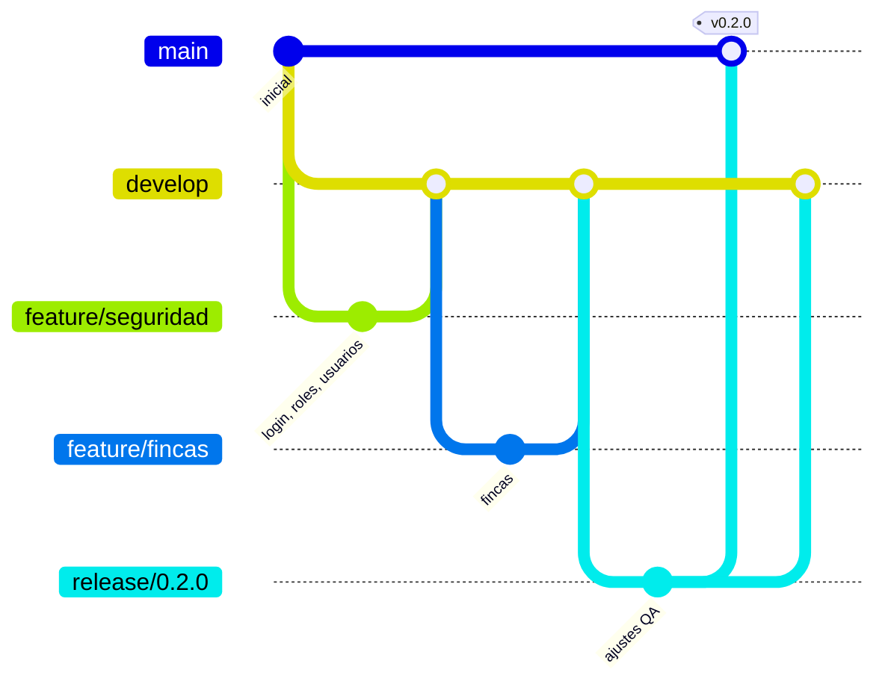

Estrategia de ramas
===================

El repositorio adopta una variante simplificada del modelo Git Flow. El diagrama ilustra el recorrido de un cambio desde una rama de funcionalidad hasta su publicación.




Tipos de rama
-------------

| Rama | Propósito | Ambiente de despliegue |
|---|---|---|
| `main` | Código en producción. Solo recibe integraciones desde `release/*` o `hotfix/*` | Producción |
| `develop` | Integración de los cambios del sprint | Desarrollo |
| `feature/<módulo>` | Desarrollo de una funcionalidad. Se crea desde `develop` y regresa a ella mediante una solicitud de integración | No aplica |
| `release/<versión>` | Estabilización previa a una publicación | Pruebas |
| `hotfix/<descripción>` | Corrección urgente sobre `main` | Producción |

Las ramas de funcionalidad previstas corresponden a los módulos del documento de requerimientos:

- `feature/seguridad`: inicio de sesión, roles, usuarios y recuperación de contraseña, correspondiente al primer sprint.
- `feature/fincas`.
- `feature/parametrizacion-especies`.
- `feature/evaluacion`.
- `feature/diagnostico-ia`.
- `feature/reportes`.
- `feature/administracion`.


Reglas de contribución
----------------------

- Ningún cambio se incorpora directamente a `main` ni a `develop`; todo cambio ingresa mediante una solicitud de integración con la integración continua aprobada.
- Los mensajes de los commits se redactan en español y en modo imperativo, por ejemplo: "Agrega filtro por rol en usuarios".
- Toda solicitud de integración que modifique la arquitectura, la API o la configuración actualiza la documentación correspondiente.
- Las migraciones de base de datos no se modifican después de integradas; cualquier ajuste se realiza con una migración nueva.


Creación de las ramas base
--------------------------

Las ramas base se crean desde una copia actualizada de `main`:

```bash
git checkout main && git pull
git checkout -b develop && git push -u origin develop
git checkout -b feature/seguridad && git push -u origin feature/seguridad
```

Se recomienda proteger las ramas `main` y `develop` desde la configuración del repositorio en GitHub (*Settings → Branches*), de modo que exijan una solicitud de integración y la aprobación de la verificación **CI**.
