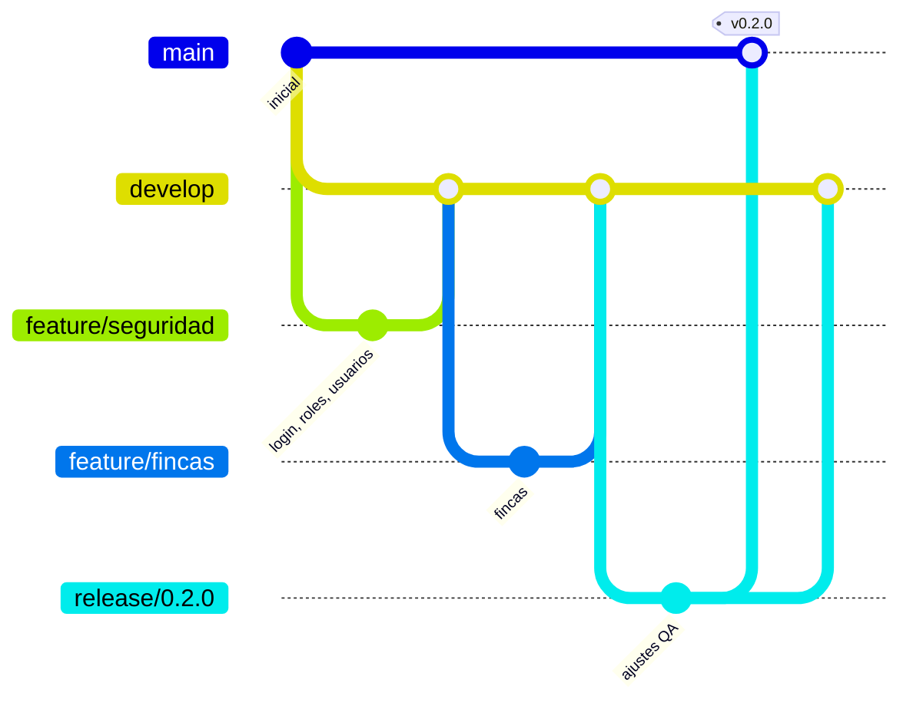

# Estrategia de ramas

Se usa un flujo tipo Git Flow simplificado.



| Rama | Para qué | Despliega en |
|---|---|---|
| `main` | Código en producción. Solo recibe merges de `release/*` o `hotfix/*` | Producción |
| `develop` | Integración del sprint | Desarrollo |
| `feature/<módulo>` | Una funcionalidad. Sale de `develop` y vuelve a `develop` por pull request | — |
| `release/<versión>` | Estabilización antes de publicar | Pruebas (QA) |
| `hotfix/<descripción>` | Corrección urgente sobre `main` | Producción |

Ramas de funcionalidad previstas, una por módulo del documento de requerimientos:

- `feature/seguridad`: login, roles, usuarios y recuperación (Sprint 1)
- `feature/fincas`
- `feature/parametrizacion-especies`
- `feature/evaluacion`
- `feature/diagnostico-ia`
- `feature/reportes`
- `feature/administracion`

## Reglas

1. Nadie sube cambios directamente a `main` ni a `develop`; todo entra por pull request con la CI en verde.
2. Mensajes de commit en español y en imperativo: "Agrega filtro por rol en usuarios".
3. Cada pull request actualiza la documentación si cambia la arquitectura, la API o la configuración.
4. Las migraciones de base de datos nunca se editan después de fusionadas; se crea una nueva.

## Crear las ramas base

```bash
git checkout main && git pull
git checkout -b develop && git push -u origin develop
git checkout -b feature/seguridad && git push -u origin feature/seguridad
```

En GitHub, en *Settings → Branches*, conviene proteger `main` y `develop`: exigir pull request y que el check **CI** esté en verde.
