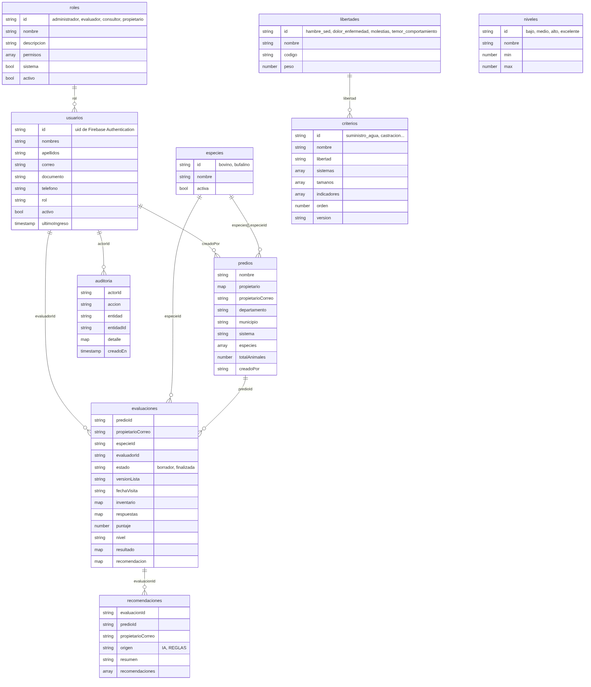

Diseño de la base de datos
==========================

ICA Bienestar Animal guarda sus datos en **Cloud Firestore**, la base de datos de documentos de Firebase, en el proyecto `bienestar-animal-ica`. Este documento presenta el modelo conceptual, la organización en colecciones y las decisiones de diseño. El detalle de cada campo está en el [diccionario de datos](DICCIONARIO-DE-DATOS.md).

| Archivo | Contenido |
|---|---|
| [DICCIONARIO-DE-DATOS.md](DICCIONARIO-DE-DATOS.md) | Las 11 colecciones con cada campo, su tipo, si es obligatorio y su descripción |
| [modelo-firestore.png](modelo-firestore.png) | Diagrama de las colecciones y sus referencias |
| `fuentes/modelo-firestore.mmd` | Código Mermaid del diagrama |
| [../../firebase/firestore.rules](../../firebase/firestore.rules) | Reglas de seguridad que protegen cada colección |

Modelo conceptual
-----------------

El modelo gira en torno a la **evaluación**: la visita en la que un evaluador aplica, sobre una especie que se cría en un predio, la lista de chequeo de la norma del ICA.

| Entidad | Representa | Requerimientos |
|---|---|---|
| Usuario y rol | Quién accede y qué puede hacer; incluye al propietario del predio | Gestión de usuarios, RNF07 |
| Predio | Finca con propietario, contacto, ubicación, sistema productivo e información adicional | Registro y gestión de predios |
| Especie e inventario | Animales por especie y grupo de edad; definen el tipo de productor y la muestra | Relación especie, cantidad y tamaño |
| Libertad, nivel y criterio | Parametrización de la norma: pesos, escala y los 23 criterios con sus indicadores | RF09 a RF12 |
| Evaluación | Aplicación de la lista de chequeo en una visita, con respuestas, puntaje y nivel | Administración y evaluación de predios |
| Recomendación | Orientación en lenguaje sencillo, generada con IA o con reglas | Informes, RF24 |
| Bitácora | Trazabilidad de las acciones | RF34 |

Colecciones
-----------

| Colección | Identificador del documento | Contenido |
|---|---|---|
| `roles` | Código en minúsculas: `administrador`, `evaluador`, `consultor`, `propietario` | Nombre, descripción y lista de permisos |
| `usuarios` | El `uid` de Firebase Authentication | Datos de la persona, rol y estado |
| `especies` | `bovino`, `bufalino` | Especies habilitadas |
| `libertades` | `hambre_sed`, `dolor_enfermedad`, `molestias`, `temor_comportamiento` | Peso de cada bloque en la nota (20, 50, 15 y 15 %) |
| `niveles` | `bajo`, `medio`, `alto`, `excelente` | Rango de la escala de 0 a 5 |
| `criterios` | `suministro_agua`, `castracion`… | Los 23 criterios con su libertad, sistemas productivos, tamaños de predio e indicadores |
| `predios` | Automático | Predio, propietario, ubicación, sistema e inventario por especie |
| `evaluaciones` | Automático | Visita, copia del inventario, respuestas, resultado y recomendaciones vigentes |
| `recomendaciones` | Automático | Historial de cada versión de las recomendaciones de una evaluación |
| `auditoria` | Automático | Una entrada por acción relevante |

Los catálogos (`especies`, `libertades`, `niveles` y `criterios`) son los que cargó el equipo en el proyecto, con el mismo formato. La semilla (`firebase/semilla.ts`) los completa con los indicadores de cada criterio y la versión de la lista.

Decisiones de diseño
--------------------

En una base de documentos se diseña según las consultas que hará la aplicación, no según la normalización. Estas son las decisiones principales:

- **El inventario va dentro del predio.** Un predio tiene pocas especies y siempre se leen junto con él, así que se guardan como lista (`especies`) en el mismo documento, sin colección aparte.
- **Las respuestas van dentro de la evaluación.** Son unas sesenta por evaluación y siempre se leen completas. Se guardan en el mapa `respuestas`, con el código del indicador como clave.
- **La evaluación copia el inventario, el sistema y la versión de la lista.** Si después cambia el predio, el informe de una evaluación anterior sigue mostrando los animales y los criterios de ese día.
- **El correo del propietario se repite en predios, evaluaciones y recomendaciones.** Las reglas de Firestore no pueden consultar otro documento al filtrar una lista; con el correo en cada documento, el propietario puede listar lo suyo y las reglas lo verifican. Cuando cambia el correo de un predio, la aplicación lo actualiza en sus evaluaciones y recomendaciones en el mismo lote, y las reglas exigen que coincida con el del predio.
- **Puntaje, nivel y resultado se guardan.** Se pueden calcular con las respuestas, pero guardarlos evita recalcular el historial y asegura que el puntaje no cambie si más adelante se ajustan las ponderaciones.
- **Las recomendaciones vigentes van en la evaluación y su historial en otra colección.** El historial del predio muestra las vigentes sin consultas extra, y cada versión queda registrada en `recomendaciones`.
- **Los informes PDF no se guardan.** Se generan en el navegador a partir de la evaluación finalizada, que ya no cambia, así que siempre salen iguales. Esto evita depender de Cloud Storage.
- **Los permisos son una lista dentro del rol.** El catálogo es fijo (`compartido/permisos.ts`), y así las reglas obtienen los permisos con una sola lectura.

Integridad y control de acceso
------------------------------

Firestore no tiene llaves foráneas ni restricciones de esquema; la integridad y el control de acceso los imponen las **reglas de seguridad**, que se evalúan en los servidores de Google en cada lectura y escritura.

| Regla | Efecto |
|---|---|
| Permisos por rol | Cada colección exige el permiso correspondiente del rol del usuario; un usuario o rol inactivo pierde todo acceso |
| Propietario | Lee solo los predios, evaluaciones finalizadas y recomendaciones con su correo, y solo si lo verificó |
| Registro | Una persona solo puede crearse a sí misma con el rol Propietario y su propio correo |
| Roles | Los roles base no se inactivan; el Administrador conserva todos los permisos; nadie cambia su propio rol ni se inactiva |
| Validación | Campos obligatorios, longitudes, correo en minúsculas, al menos una especie y sistema productivo dentro de la lista |
| Referencias | La evaluación debe apuntar a un predio existente y copiar su correo; la recomendación, a una evaluación finalizada |
| Evaluación finalizada | No se modifica, salvo para volver a generar sus recomendaciones; al finalizar, el nivel debe coincidir con el puntaje |
| Bitácora | Cada quien registra solo sus propias acciones, con la hora del servidor; nadie modifica ni borra entradas |
| Borrado | No se permite borrar documentos desde la aplicación; los registros se inactivan |

Las operaciones que afectan varios documentos (finalizar una evaluación, crear un predio o un usuario con su registro de auditoría) se guardan en un **lote**: se aplican todas o ninguna. Las pruebas de estas reglas están en `firebase/pruebas/reglas.test.ts` y se ejecutan en el emulador con `npm run test:reglas`.

Consultas e índices
-------------------

Todas las consultas de la aplicación usan filtros de igualdad, que Firestore resuelve con sus índices automáticos de un solo campo; por eso `firestore.indexes.json` no define índices compuestos.

| Consulta | Filtros |
|---|---|
| Predios del propietario | `propietarioCorreo` |
| Historial de un predio | `predioId`, y para el propietario además `propietarioCorreo` y `estado` |
| Evaluación en curso de una especie | `predioId`, `especieId` y `estado` |
| Última evaluación de cada predio | `estado`, y para el propietario además `propietarioCorreo` |

Respaldo
--------

Con el plan Blaze se programa un respaldo diario de Firestore (ver [DESPLIEGUE.md](../DESPLIEGUE.md)). El esquema no requiere migraciones: los campos nuevos se agregan a los documentos nuevos, y la semilla actualiza los catálogos.
