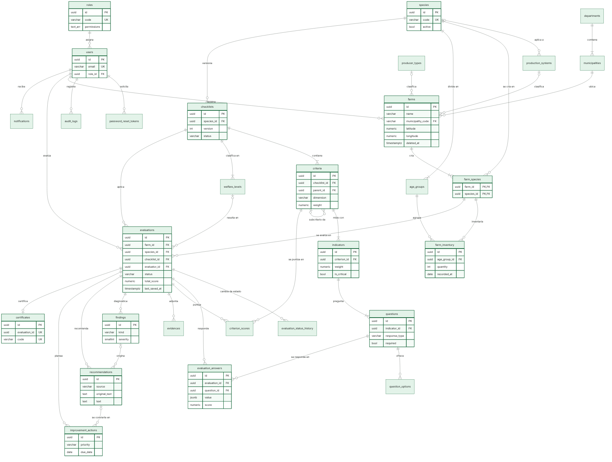
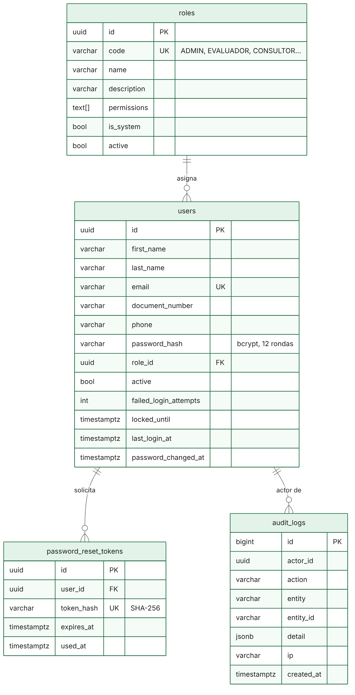

Diseño de la base de datos
==========================

Este documento presenta el diseño de la base de datos de ICA Bienestar Animal en sus tres niveles: conceptual, lógico y físico. El motor es PostgreSQL 16, administrado en Cloud SQL en producción (RNFG03).

| Archivo | Contenido |
|---|---|
| [modelo-completo.sql](modelo-completo.sql) | Script DDL del modelo completo, validado sobre una base vacía |
| [DICCIONARIO-DE-DATOS.md](DICCIONARIO-DE-DATOS.md) | Las 29 tablas con cada columna, tipo, nulidad, valor por defecto, llave y descripción |
| [er-completo.png](er-completo.png) | Diagrama entidad relación del sistema completo |
| [er-seguridad.png](er-seguridad.png) | Diagrama entidad relación del módulo implementado, con todas sus columnas |
| `fuentes/` | Código Mermaid de los diagramas |


Alcance
-------

El modelo cubre los requerimientos funcionales del documento *Requerimientos funcionales Aplicación ICA – Bienestar Animal*. Se divide en dos partes:

- **Implementado.** Las cuatro tablas del módulo de seguridad (`roles`, `users`, `password_reset_tokens` y `audit_logs`) existen en el código y se crean con la migración `backend/src/database/migrations/1792014831263-InitialSecurity.ts`.
- **Diseñado.** Las 25 tablas restantes corresponden a los módulos de los próximos sprints. Su estructura queda definida y validada en el script; cada módulo se incorporará al código con su propia migración de TypeORM, sin modificar las tablas ya existentes (RNF03, RNF30).


Modelo conceptual
-----------------

El modelo gira en torno a la **evaluación**: una visita en la que un evaluador aplica, sobre una especie que se cría en una finca, la versión vigente de la lista de chequeo de esa especie.

| Entidad | Representa | Requerimientos |
|---|---|---|
| Usuario y rol | Quién accede y qué puede hacer | RF01 a RF04, RNF07 |
| Finca | Predio con propietario, ubicación y especies | RF05 a RF07 |
| Inventario | Número de animales por grupo etario | RF08 |
| Especie | Bovinos, porcinos, aves u otra especie habilitada | RF09, RF38 |
| Lista de chequeo | Instrumento versionado de una especie | RF09, RNF28 |
| Criterio, indicador y pregunta | Jerarquía del instrumento, con ponderaciones | RF10 a RF12 |
| Nivel de bienestar | Rangos de puntaje y su clasificación | RF21 |
| Evaluación | Aplicación del instrumento en una visita | RF13 a RF20, RF36 |
| Respuesta y evidencia | Lo que el evaluador registra en campo | RF15, RF18, RF19 |
| Hallazgo | Fortaleza, incumplimiento, alerta crítica u oportunidad | RF22, RF23 |
| Recomendación | Sugerencia de la IA, de las reglas o del evaluador | RF24 a RF26 |
| Acción de mejora | Compromiso con responsable, prioridad y plazo | RF27 |
| Certificado | Constancia de cumplimiento enviada por correo | RF38 |
| Notificación y bitácora | Avisos a los usuarios y trazabilidad | RF34, RF40 |


Modelo lógico
-------------

El diagrama entidad relación completo se encuentra en [er-completo.png](er-completo.png). Para mantenerlo legible, muestra solo las llaves y los atributos que definen cada relación; el detalle de columnas está en el diccionario de datos.



El módulo implementado se presenta con todas sus columnas:



**Relaciones principales**

| Relación | Cardinalidad | Regla |
|---|---|---|
| Rol a usuario | Uno a muchos | Un usuario tiene exactamente un rol; un rol con usuarios no se elimina, se inactiva |
| Finca a especie | Muchos a muchos, mediante `farm_species` | Una finca cría una o varias especies |
| Especie a lista de chequeo | Uno a muchos | Cada cambio del instrumento crea una versión nueva; solo una está publicada |
| Lista de chequeo a criterio, indicador y pregunta | Composición | Al borrar una versión en borrador se borra su jerarquía |
| Criterio a criterio | Recursiva | Un criterio puede tener subcriterios |
| Finca y especie a evaluación | Uno a muchos, con llave compuesta | Solo se evalúa una especie que la finca tiene registrada |
| Evaluación a lista de chequeo | Muchos a uno | La evaluación conserva la versión con la que se diligenció, aunque luego se publique otra |
| Evaluación a respuesta | Uno a muchos | Una respuesta por pregunta y evaluación |
| Hallazgo a recomendación a acción de mejora | Uno a muchos encadenado | Permite rastrear cada acción hasta el hallazgo que la originó |
| Evaluación a certificado | Uno a cero o uno | Solo si el nivel obtenido es certificable |


Normalización
-------------

El modelo está en tercera forma normal. Cada tabla tiene una llave primaria, los atributos dependen solo de ella y no hay dependencias transitivas: los nombres de municipio, especie, tipo de productor o sistema productivo viven en sus catálogos y las demás tablas los referencian por llave.

Se admiten tres desnormalizaciones deliberadas:

- **`roles.permissions` como arreglo de texto.** Los permisos son un catálogo fijo definido en el código (`backend/src/roles/permissions.ts`), y el arreglo evita una tabla intermedia y una consulta adicional en cada petición autenticada.
- **`evaluations.total_score` y `criterion_scores`.** Son valores calculables a partir de las respuestas, pero se guardan para que el historial, los tableros y los reportes no recalculen cada evaluación (RNF09, RNF10) y para que el puntaje no cambie si más adelante se modifican las ponderaciones.
- **`evaluation_answers.value` como JSONB.** Las preguntas admiten siete tipos de respuesta (RF12); una sola columna JSONB evita siete columnas casi siempre vacías.


Integridad
----------

| Mecanismo | Uso |
|---|---|
| Llaves foráneas | Todas las relaciones; `ON DELETE CASCADE` solo en composiciones, como tokens de un usuario o respuestas de una evaluación |
| Restricciones `CHECK` | Estados y tipos con dominio cerrado, rangos de coordenadas, puntajes entre 0 y 100, tamaño máximo de evidencias y coherencia de escalas |
| Índice único parcial | `ux_checklists_published` garantiza una sola versión publicada por especie |
| Llave foránea compuesta | `evaluations (farm_id, species_id)` contra `farm_species` impide evaluar una especie que la finca no cría |
| Eliminación lógica | `farms.deleted_at` conserva el historial de evaluaciones de una finca eliminada |
| Identificadores UUID | Evitan exponer consecutivos en la API; la bitácora usa `bigserial` por volumen y orden |


Índices
-------

Además de las llaves primarias y únicas, se definen índices para las consultas frecuentes:

| Índice | Consulta que atiende |
|---|---|
| `ux_users_email` | Ingreso por correo |
| `ix_audit_logs_actor`, `ix_audit_logs_created` | Bitácora por usuario y por periodo |
| `ix_farms_municipality`, `ix_farms_name` | Búsqueda de fincas por municipio y por nombre sin distinguir mayúsculas (RF33) |
| `ix_evaluations_farm` | Historial de una finca ordenado por fecha (RF28, RF29) |
| `ix_evaluations_status`, `ix_evaluations_evaluator` | Bandejas de evaluaciones pendientes por estado y por evaluador |
| `ix_findings_evaluation` | Hallazgos más severos primero (RF23) |
| `ix_notifications_unread` | Contador de notificaciones sin leer, índice parcial |


Seguridad de los datos
----------------------

- Las contraseñas se guardan con bcrypt de 12 rondas; los tokens de recuperación, como resumen SHA-256.
- La conexión desde Cloud Run usa el conector de Cloud SQL y la contraseña de la base se lee desde Secret Manager (RNFG06).
- Cloud SQL cifra los datos almacenados y las copias de respaldo; las conexiones viajan cifradas (RNF06).
- Los datos personales de propietarios se limitan a nombre, documento, teléfono y correo, necesarios para contactar al responsable del predio (RNF27).
- Las evidencias no se guardan en la base: se almacena la ruta del objeto en Cloud Storage (RNF11, RNFG02).


Respaldo y migraciones
----------------------

La instancia de Cloud SQL se crea con respaldos automáticos diarios y recuperación a un punto en el tiempo (opciones `--backup-start-time` y `--enable-point-in-time-recovery`, ver [ARQUITECTURA.md](../ARQUITECTURA.md)), lo que atiende el RNF20. El esquema evoluciona solo mediante migraciones versionadas de TypeORM, que se ejecutan en cada despliegue con `npm run migration:run:prod`; nunca se modifica la base a mano.

Para revisar el modelo completo en un equipo local:

```
createdb ica_bienestar_modelo
psql -d ica_bienestar_modelo -f docs/base-de-datos/modelo-completo.sql
```
