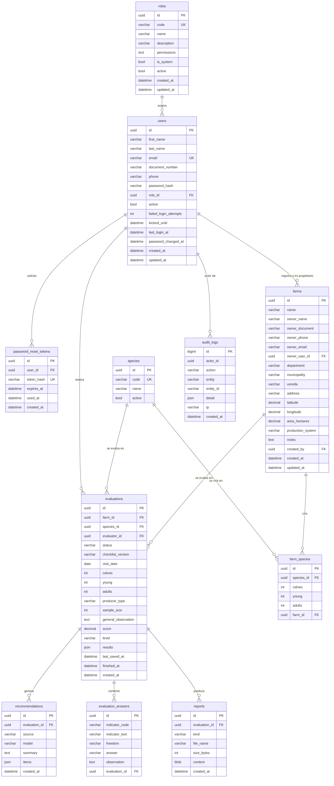

Diseño de la base de datos
==========================

Este documento presenta el diseño de la base de datos de ICA Bienestar Animal en sus tres niveles: conceptual, lógico y físico. El sistema gestor es **MariaDB 11.4** (compatible desde la 10.11), con el motor InnoDB y el juego de caracteres `utf8mb4`, como lo exige la sección *Base de datos* de los requerimientos técnicos.

| Archivo | Contenido |
|---|---|
| [esquema-mariadb.sql](esquema-mariadb.sql) | Script DDL generado de la base después de aplicar las migraciones |
| [DICCIONARIO-DE-DATOS.md](DICCIONARIO-DE-DATOS.md) | Las 11 tablas con cada columna, tipo, nulidad, valor por defecto, llave y descripción |
| [er-implementado.png](er-implementado.png) | Diagrama entidad relación con todas las columnas |
| `fuentes/er-implementado.mmd` | Código Mermaid del diagrama |

El esquema se crea y evoluciona solo con las migraciones de TypeORM de `backend/src/database/migrations/`. El script DDL y el diccionario se generan del catálogo de MariaDB después de aplicarlas, por lo que siempre describen la base real.


Modelo conceptual
-----------------

El modelo gira en torno a la **evaluación**: la visita en la que un evaluador aplica, sobre una especie que se cría en un predio, la lista de chequeo de esa especie según la norma del ICA.

| Entidad | Representa | Requerimientos |
|---|---|---|
| Usuario y rol | Quién accede y qué puede hacer; incluye al propietario del predio | Gestión de usuarios, RNF07 |
| Predio | Finca con propietario, contacto, ubicación e información adicional | Registro y gestión de predios |
| Especie | Bovinos, búfalos u otra especie habilitada | Registro de predios, RF09 |
| Inventario por especie | Crías, jóvenes y adultos; define el tipo de productor y la muestra | Relación especie, cantidad y tamaño |
| Evaluación | Aplicación de la lista de chequeo en una visita, con su puntaje y nivel | Administración y evaluación de predios |
| Respuesta | Lo que el evaluador registra para cada indicador | RF15, RF18 |
| Recomendación | Orientación en lenguaje sencillo, generada con IA o con reglas | Informes, RF24 |
| Informe | PDF técnico y PDF para el propietario | Informes en PDF |
| Bitácora | Trazabilidad de las acciones | RF40 |

La lista de chequeo (indicadores, libertades y ponderaciones) es parte del código, en `compartido/lista-chequeo.ts`, con una versión (`REF-2026.1`). Cada evaluación guarda la versión que aplicó y una copia del texto de cada indicador respondido, de modo que un cambio posterior en la lista no altera el historial.


Modelo lógico
-------------



**Relaciones**

| Relación | Cardinalidad | Regla |
|---|---|---|
| Rol a usuario | Uno a muchos | Un usuario tiene exactamente un rol; un rol con usuarios no se elimina, se inactiva |
| Usuario a predio, como propietario | Uno a muchos, opcional | El predio se vincula a la cuenta del propietario por su correo; si la cuenta se elimina, el vínculo queda en nulo |
| Usuario a predio, como autor del registro | Uno a muchos | Se conserva quién registró cada predio |
| Predio a especie | Muchos a muchos, mediante `farm_species` | Un predio cría una o varias especies, cada una una sola vez, con su inventario |
| Predio y especie a evaluación | Uno a muchos | Se evalúa una especie a la vez; solo puede haber un borrador por predio y especie |
| Evaluación a respuesta | Composición | Una respuesta por indicador y evaluación; se borran con la evaluación |
| Evaluación a recomendación | Uno a muchos | Cada nueva generación crea un registro; el historial muestra la más reciente |
| Evaluación a informe | Uno a muchos | Un informe técnico y uno para el propietario, que se regenera con las recomendaciones |


Normalización
-------------

El modelo está en tercera forma normal: cada tabla tiene llave primaria, los atributos dependen solo de ella y no hay dependencias transitivas. Se admiten desnormalizaciones deliberadas, todas para preservar el historial o simplificar el acceso:

- **Copia del inventario en `evaluations`.** Crías, jóvenes, adultos, tipo de productor y muestra se copian al iniciar la evaluación. Si después se actualiza el inventario del predio, el informe de una evaluación anterior sigue mostrando los animales que había ese día.
- **`evaluations.score`, `level` y `results`.** Se pueden calcular con las respuestas, pero se guardan para que el historial y los informes no recalculen y para que el puntaje no cambie si más adelante se ajustan las ponderaciones de la norma.
- **`evaluation_answers.indicator_text`.** Copia del texto del indicador al responder, por la misma razón.
- **`roles.permissions` como lista de texto.** Los permisos son un catálogo fijo definido en el código (`backend/src/roles/constants/permissions.ts`); la lista evita una tabla intermedia y una consulta adicional en cada petición.
- **Columnas JSON** (`audit_logs.detail`, `evaluations.results`, `recommendations.items`). Guardan estructuras que se leen siempre completas y no se filtran por su contenido. MariaDB las valida con `json_valid`.


Integridad
----------

| Mecanismo | Uso |
|---|---|
| Llaves foráneas | Todas las relaciones. `ON DELETE CASCADE` solo en composiciones (inventario de un predio, respuestas, recomendaciones e informes de una evaluación, tokens de un usuario); `SET NULL` en el vínculo del propietario |
| Restricciones únicas | Correo del usuario, código de rol, código de especie, especie por predio (`farm_id`, `species_id`) e indicador por evaluación (`evaluation_id`, `indicator_code`) |
| Columnas obligatorias | Las llaves de las composiciones son `NOT NULL`: no puede existir un inventario sin predio ni una respuesta sin evaluación |
| Validación JSON | Restricción `CHECK (json_valid(...))` en las columnas JSON |
| Reglas en el servicio de aplicación | Dominios cerrados (estado, respuesta, nivel, tipo de informe), un solo borrador por predio y especie, respuestas de sí o no sin opción parcial y evaluación finalizada sin modificaciones |
| Transacciones | Al finalizar, la evaluación, sus recomendaciones, los dos informes y el registro de auditoría se guardan en una sola transacción |
| Identificadores UUID | Evitan exponer consecutivos en la API; la bitácora usa un entero autoincremental por volumen y orden |


Índices
-------

Además de las llaves primarias, únicas y foráneas, se definen índices para las consultas frecuentes:

| Índice | Consulta que atiende |
|---|---|
| `users (email)`, único | Ingreso por correo |
| `farms (name)` | Búsqueda y orden de predios por nombre |
| `farms (owner_email)` | Predios del propietario que ingresa con su correo |
| `evaluations (farm_id, created_at)` | Historial de un predio en orden cronológico |
| `audit_logs (actor_id)`, `audit_logs (created_at)` | Bitácora por usuario y por periodo |


Control de acceso
-----------------

El acceso a los datos se controla en dos niveles:

- **En la base.** La aplicación se conecta con un usuario de MariaDB que solo tiene permisos sobre la base `ica_bienestar`; el usuario `root` no se usa desde la aplicación. En el servidor, MariaDB no publica su puerto y solo es alcanzable desde la red interna del servicio de aplicación (ver [DESPLIEGUE.md](../DESPLIEGUE.md)).
- **En el servicio de aplicación.** Cada consulta de predios se filtra según los permisos del usuario: quien tiene `fincas.ver` o `fincas.gestionar` ve todos los predios; quien solo tiene `predios.propios` ve los predios vinculados a su cuenta o registrados con su correo, y de ellos solo las evaluaciones finalizadas.


Seguridad de los datos
----------------------

- Las contraseñas se guardan con bcrypt; los tokens de recuperación, como resumen SHA-256.
- Las credenciales de la base se leen de variables de entorno que nunca se suben al repositorio.
- Los datos personales del propietario se limitan a nombre, documento, teléfono y correo, necesarios para contactarlo. No se envían al servicio de IA.
- La bitácora registra la creación y edición de predios, el inicio y la finalización de evaluaciones y la regeneración de recomendaciones.


Respaldo y migraciones
----------------------

El servidor ejecuta un respaldo diario con `mariadb-dump --single-transaction` y conserva catorce días (ver [DESPLIEGUE.md](../DESPLIEGUE.md)). El esquema evoluciona solo mediante migraciones versionadas de TypeORM, que el servicio de aplicación aplica al iniciar; nunca se modifica la base a mano.

Para revisar el esquema en un equipo local con MariaDB:

```
mariadb -u root -p -e "CREATE DATABASE ica_modelo CHARACTER SET utf8mb4 COLLATE utf8mb4_unicode_ci"
mariadb -u root -p ica_modelo < docs/base-de-datos/esquema-mariadb.sql
```
