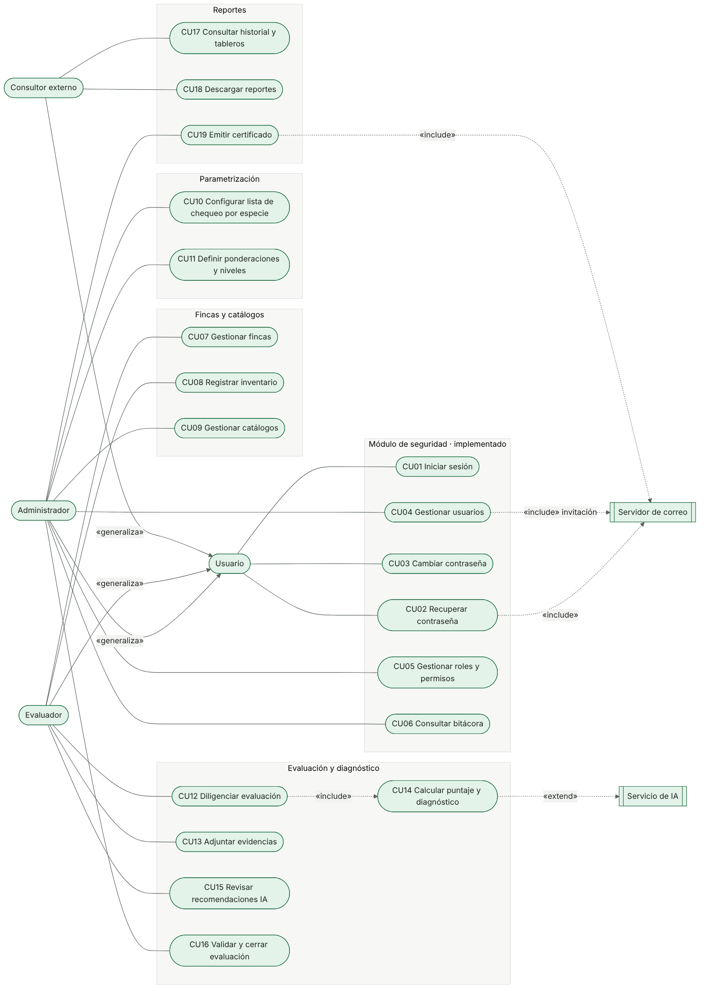
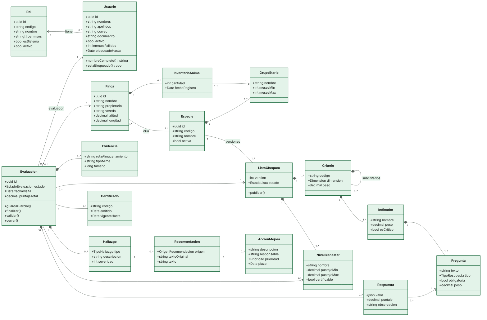
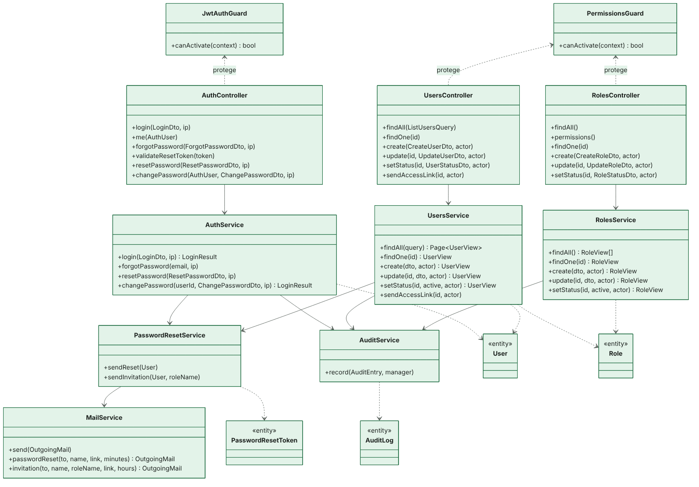
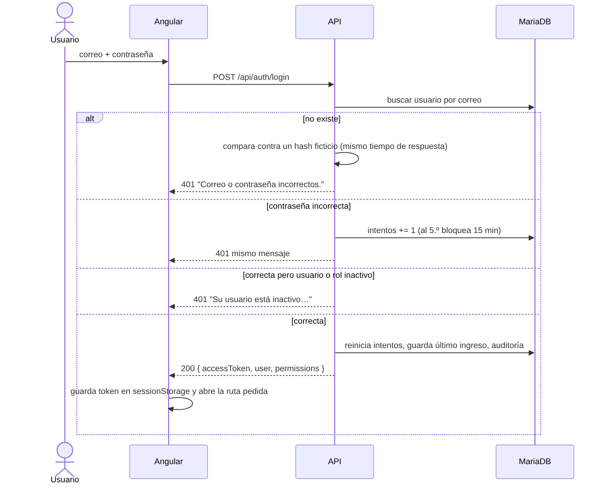
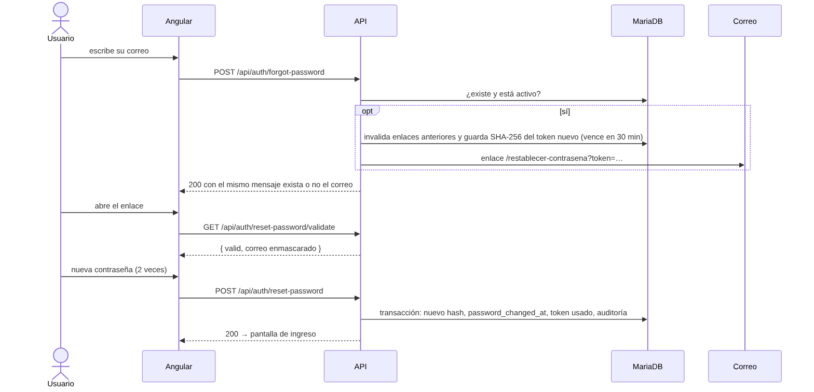
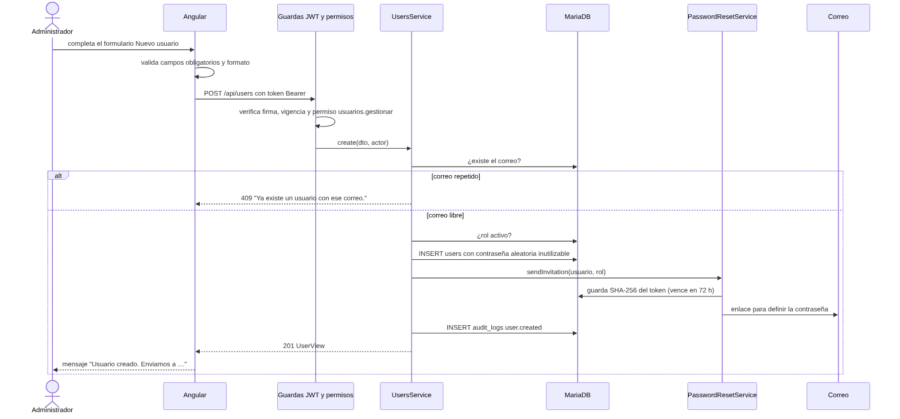
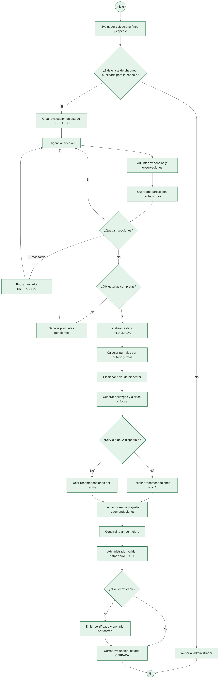
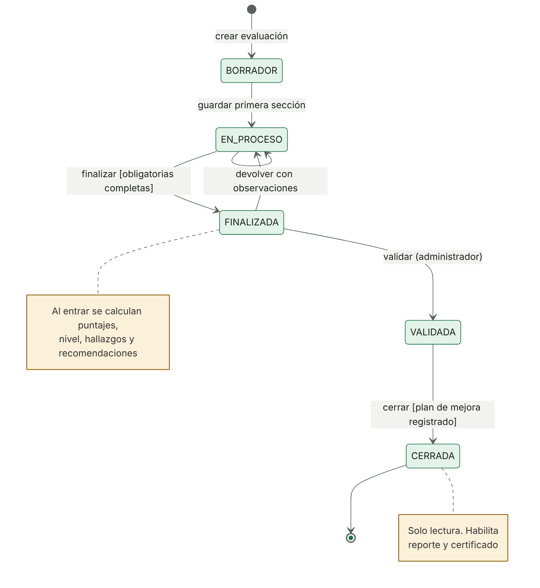
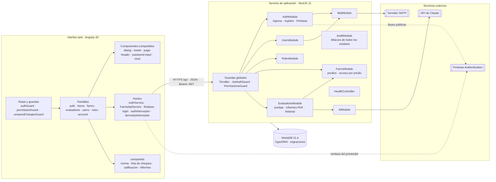
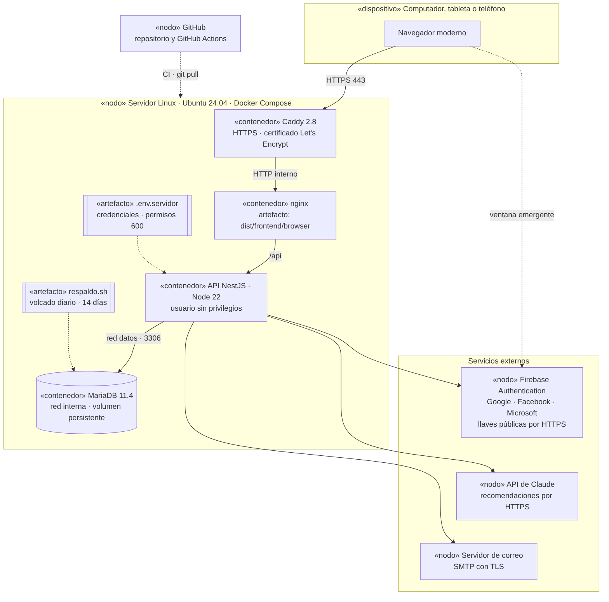

Diagramas UML
=============

Este documento reúne los diagramas UML de ICA Bienestar Animal. Los diagramas del módulo de seguridad describen el código que ya existe; los de evaluación, diagnóstico y reportes describen el diseño de los próximos sprints y se rotulan como tales. Cada imagen se genera a partir de su código Mermaid, guardado en la carpeta `fuentes/`, de modo que los diagramas se versionan junto con el código.

| Diagrama | Vista | Estado |
|---|---|---|
| Casos de uso | Funcional | Seguridad implementada; demás módulos diseñados |
| Clases del dominio | Estructural | Diseño completo |
| Clases del servicio de aplicación | Estructural | Implementado |
| Secuencia de ingreso | Comportamiento | Implementado |
| Secuencia de recuperación de contraseña | Comportamiento | Implementado |
| Secuencia de creación de usuario | Comportamiento | Implementado |
| Actividad de una evaluación | Comportamiento | Implementado hasta el diagnóstico y las recomendaciones; validación y cierre diseñados |
| Estados de una evaluación | Comportamiento | Parcial: borrador y finalizada implementados |
| Componentes | Arquitectura | Implementado |
| Despliegue | Arquitectura | Implementado |


Casos de uso
------------

Los tres actores heredan del actor Usuario los casos comunes de acceso. Las líneas punteadas indican inclusión o extensión hacia los sistemas externos.



| Caso | Actor principal | Requerimientos |
|---|---|---|
| CU01 Iniciar sesión | Usuario | RF01, RNF05 |
| CU02 Recuperar contraseña | Usuario | RF04 |
| CU03 Cambiar contraseña | Usuario | RF01 |
| CU04 Gestionar usuarios | Administrador | RF03 |
| CU05 Gestionar roles y permisos | Administrador | RF02, RNF07 |
| CU06 Consultar bitácora | Administrador | RF34, RNF08 |
| CU07 Gestionar fincas | Evaluador | RF05, RF06, RF07 |
| CU08 Registrar inventario | Evaluador | RF08 |
| CU09 Gestionar catálogos | Administrador | RF35, RF38 |
| CU10 Configurar lista de chequeo por especie | Administrador | RF09, RF10, RF12 |
| CU11 Definir ponderaciones y niveles | Administrador | RF11, RF21 |
| CU12 Diligenciar evaluación | Evaluador | RF13 a RF18 |
| CU13 Adjuntar evidencias | Evaluador | RF19 |
| CU14 Calcular puntaje y diagnóstico | Sistema | RF20 a RF24 |
| CU15 Revisar recomendaciones IA | Evaluador | RF25 a RF27 |
| CU16 Validar y cerrar evaluación | Administrador | RF36 |
| CU17 Consultar historial y tableros | Consultor externo | RF28 a RF30 |
| CU18 Descargar reportes | Consultor externo | RF31, RF32 |
| CU19 Emitir certificado | Administrador | RF38 |

**Especificación del caso CU01 Iniciar sesión**

| Elemento | Descripción |
|---|---|
| Precondición | La persona tiene una cuenta activa con un rol activo |
| Flujo principal | La persona escribe correo y contraseña; el sistema verifica las credenciales, registra el ingreso en la bitácora y abre la pantalla de inicio o la que se había pedido |
| Flujo alterno: credenciales incorrectas | El sistema responde con un mensaje que no revela si el correo existe y suma un intento fallido |
| Flujo alterno: cinco intentos fallidos | La cuenta se bloquea durante 15 minutos |
| Flujo alterno: cuenta o rol inactivo | El sistema informa que el usuario está inactivo y no entrega token |
| Postcondición | La sesión queda abierta con un token JWT que vence a las ocho horas |

**Especificación del caso CU04 Gestionar usuarios**

| Elemento | Descripción |
|---|---|
| Precondición | El administrador tiene el permiso `usuarios.gestionar` |
| Flujo principal | El administrador registra nombres, apellidos, correo, rol y, de forma opcional, documento y teléfono; el sistema crea la cuenta y envía una invitación para que la persona defina su contraseña |
| Flujo alterno: correo repetido | El sistema rechaza el registro e indica que el correo ya existe |
| Flujo alterno: edición | Se modifican los datos o el rol; si cambia el rol, las sesiones abiertas de esa persona se cierran |
| Flujo alterno: inactivación | Se pide confirmación; la persona pierde el acceso de inmediato. El administrador no puede inactivarse a sí mismo |
| Postcondición | Cada operación queda registrada en la bitácora de auditoría |


Clases del dominio
------------------

Modelo de clases del sistema completo. Las composiciones (rombo relleno) indican partes que no existen sin su contenedor, como las preguntas de un indicador o las respuestas de una evaluación.




Clases del servicio de aplicación
---------------------------------

Clases del servicio NestJS que implementan el módulo de seguridad. Los controladores reciben las peticiones, los servicios contienen las reglas de negocio y las entidades de TypeORM representan las tablas. Las guardas globales verifican el token y los permisos antes de que la petición llegue al controlador.




Secuencia de ingreso
--------------------




Secuencia de recuperación de contraseña
---------------------------------------




Secuencia de creación de usuario
--------------------------------




Actividad de una evaluación
---------------------------

Recorrido completo de una evaluación desde la visita hasta el cierre. El diagrama incluye la tolerancia a fallos exigida por el RNF26: si el servicio de IA no responde, el diagnóstico continúa con recomendaciones basadas en reglas.




Estados de una evaluación
-------------------------

Los cinco estados exigidos por el RF36 y las transiciones permitidas entre ellos. La versión actual implementa los estados borrador y finalizada; la validación y el cierre por un segundo evaluador están planeados para un sprint posterior.




Componentes
-----------

La interfaz se comunica con el servicio de aplicación solo por `/api`. Las reglas de la norma, el cálculo del puntaje y los informes viven en `compartido/` y se usan en ambos lados. Firebase solo confirma la identidad; la autorización la decide el servicio con los roles guardados en MariaDB.




Despliegue
----------

El sistema se ejecuta en un servidor Linux con Docker Compose. Solo Caddy recibe tráfico de internet; la base de datos está en una red interna sin puerto publicado. El procedimiento completo está en [DESPLIEGUE.md](../DESPLIEGUE.md).




Regenerar las imágenes
----------------------

Las imágenes se generan con la herramienta de línea de comandos de Mermaid. Desde la carpeta `docs`:

```
npx -y @mermaid-js/mermaid-cli@11.4.2 -i uml/fuentes/casos-de-uso.mmd -o uml/casos-de-uso.png -b white -s 2
```
